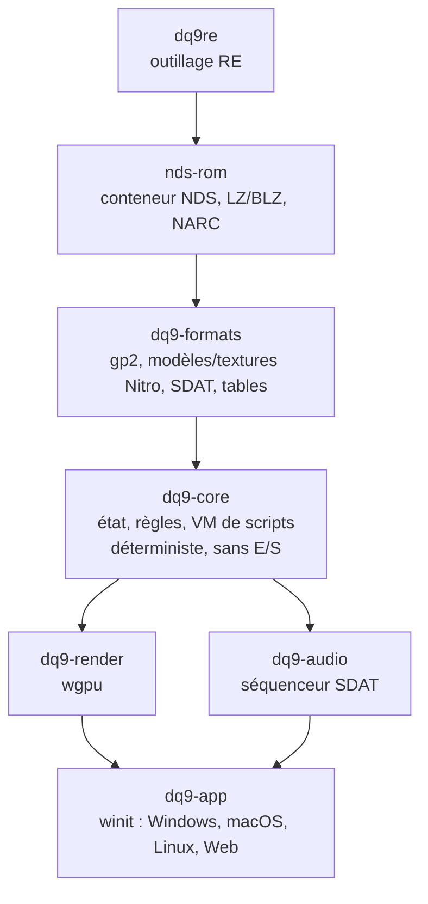

# Architecture cible du portage

Approche : **réimplémentation** en Rust (comme OpenMW ou les ports issus de décompilation),
pas un émulateur. La logique du jeu est réécrite à partir de l'analyse du code ARM9 ; les
ressources sont lues **à l'exécution depuis la ROM du joueur** et ne sont jamais
redistribuées.

État : `nds-rom`, `dq9-formats` (compression Level-5, GPC2, tables, polices, messages, choix
des répliques, triggers et leurs actions, scripts d'événements, cartes), `dq9-core` (requêtes
de sol et mouvement provisoire), `dq9-render` (cartes en wgpu), `dq9-app` (fenêtre native et
Web, `app.md`) et `dq9re` existent. `dq9-audio` sera créée quand son sous-système aura été
documenté dans `docs/re/`.

## Règles

- **Portabilité** : `nds-rom`, `dq9-formats`, `dq9-render` et `dq9-core` ne font aucune E/S
  et compilent pour `wasm32-unknown-unknown` (vérifié en CI, avec `dq9-app`). Seule `dq9-app`
  touche au système.
- **Déterminisme** : `dq9-core` avance par pas fixes (60 Hz comme la DS) à partir d'entrées
  explicites, ce qui permet les replays et la comparaison avec l'émulateur.
- **Données non fiables** : tout parseur renvoie une erreur sur une donnée corrompue, jamais
  de panique.
- **Traçabilité** : chaque comportement réimplémenté cite la fonction d'origine
  (`// ov_017::0218c0f4`) et le format correspondant est décrit dans `docs/re/`. Les
  fonctions entièrement réimplémentées sont listées dans un marqueur `port:`, qui mesure
  l'avancement (`docs/roadmap.md`).

## Vérification

1. Tests unitaires sur données synthétiques (formats, cas limites).
2. Tests sur la vraie ROM (`crates/*/tests/real_rom.rs`), ignorés automatiquement sans ROM.
3. Comparaison différentielle avec melonDS (stub GDB) : même entrée → même état mémoire
   des structures réimplémentées.
