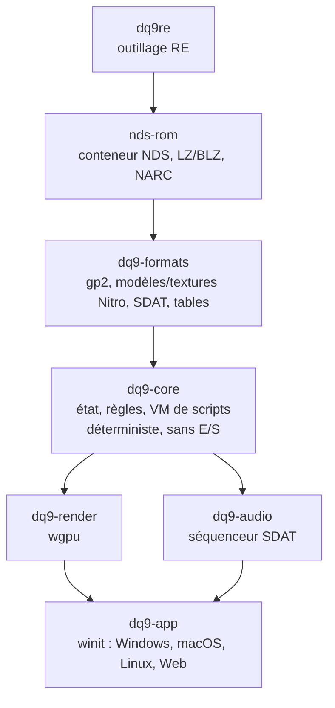

# Architecture cible du portage

Approche : **réimplémentation** en Rust (comme OpenMW ou les ports issus de décompilation),
pas un émulateur. La logique du jeu est réécrite à partir de l'analyse du code ARM9 ; les
ressources sont lues **à l'exécution depuis la ROM du joueur** et ne sont jamais
redistribuées.

État : toutes les crates du schéma existent, plus `dq9re` (CLI de RE) et `testrom`
(localisation de la ROM pour les tests). `dq9-core` porte l'état du jeu (sauvegarde ou
nouvelle partie), le déplacement et les collisions en `fx32`, la caméra, les portes et zones,
les triggers, les conversations, l'interpréteur `.stb` et l'enchaînement des scènes ;
`dq9-app` les joue en natif et dans le navigateur (`app.md`). Avancement fonctionnel :
[`status.md`](status.md).

## Règles

- **Portabilité** : `nds-rom`, `dq9-formats`, `dq9-render`, `dq9-audio` et `dq9-core` ne font aucune E/S
  et compilent pour `wasm32-unknown-unknown` (vérifié en CI, avec `dq9-app`). Seule `dq9-app`
  touche au système.
- **Déterminisme** : `dq9-core` avance par pas fixes à partir d'entrées explicites, ce qui
  permet les replays et la comparaison avec l'émulateur. Comme sur la DS, la boucle de
  `dq9-app` tourne à 60 Hz (un VBlank) et le champ à 30 Hz : `Hero::step(ticks = 2)` et
  `Field::step` aux images impaires (`App::run_steps`, `GameState+0x3c4`), pose tenue à
  l'image intermédiaire ; audio, portes, dialogues, VM d'événements, caméra et rendu restent
  à 60 Hz ([`re/movement.md`](re/movement.md)).
- **Données non fiables** : tout parseur renvoie une erreur sur une donnée corrompue, jamais
  de panique.
- **Traçabilité** : chaque comportement réimplémenté cite la fonction d'origine
  (`// ov_017::0218c0f4`) et le format correspondant est décrit dans `docs/re/`. Les
  fonctions entièrement réimplémentées sont listées dans un marqueur `port:`, qui mesure
  l'avancement (`docs/roadmap.md`).

## Vérification

`scripts/verify.ps1` est la seule source des commandes de vérification (fmt, clippy, tests,
build wasm des crates sans E/S et de `dq9-app`, bloc d'avancement) : la CI, `AGENTS.md` et
les docs l'appellent.

1. Tests unitaires sur données synthétiques (formats, cas limites).
2. Tests sur la vraie ROM (`crates/*/tests/real_rom.rs`), ignorés automatiquement sans ROM ;
   `verify.ps1 -RequireRom` échoue si aucune ROM n'est trouvée.
3. Comparaison automatisée à l'original : `scripts/parity.ps1` rejoue des références
   produites par l'émulateur (harnais libretro melonDS DS) sur le runtime headless et échoue
   sur tout écart non accepté explicitement.
