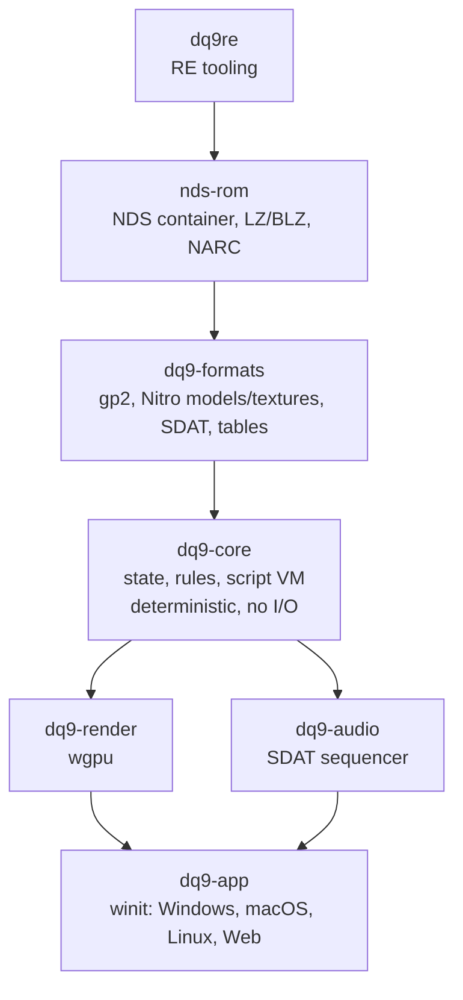

# Target architecture of the port

Approach: a **reimplementation** in Rust (like OpenMW or decompilation-based ports),
not an emulator. Game logic is rewritten from analysis of the ARM9 code; assets are
read **at runtime from the player's ROM** and are never redistributed.

Status: every crate in the diagram exists, plus `dq9re` (RE CLI) and `testrom`
(ROM lookup for tests). `dq9-core` holds the game state (save or new game), movement and
collisions in `fx32`, the camera, doors and zones, triggers, conversations, the `.stb`
interpreter and cutscene sequencing; `dq9-app` plays them natively and in the browser
(`app.md`). Functional progress: [`status.md`](status.md).

## Rules

- **Portability**: `nds-rom`, `dq9-formats`, `dq9-render`, `dq9-audio` and `dq9-core` do no I/O
  and compile for `wasm32-unknown-unknown` (checked in CI, along with `dq9-app`). Only `dq9-app`
  touches the system.
- **Determinism**: `dq9-core` advances in fixed steps from explicit inputs, which enables
  replays and comparison with the emulator. As on the DS, the `dq9-app` loop runs at 60 Hz
  (one VBlank) and the field at 30 Hz: `Hero::step(ticks = 2)` and `Field::step` on odd
  frames (`App::run_steps`, `GameState+0x3c4`), pose held on the in-between frame; audio,
  doors, dialogue, event VM, camera and rendering stay at 60 Hz
  ([`re/movement.md`](re/movement.md)).
- **Untrusted data**: every parser returns an error on corrupt data, never a panic.
- **Traceability**: every reimplemented behavior cites the original function
  (`// ov_017::0218c0f4`) and the matching format is described in `docs/re/`. Fully
  reimplemented functions are listed in a `port:` marker, which measures progress
  (`docs/roadmap.md`).

## Verification

`scripts/verify.ps1` is the single source of verification commands (fmt, clippy, tests,
wasm build of the I/O-free crates and of `dq9-app`, progress block): CI, `AGENTS.md` and
the docs call it.

1. Unit tests on synthetic data (formats, edge cases).
2. Tests on the real ROM (`crates/*/tests/real_rom.rs`), skipped automatically without a ROM;
   `verify.ps1 -RequireRom` fails if no ROM is found.
3. Automated comparison with the original: `scripts/parity.ps1` replays references
   produced by the emulator (melonDS DS libretro harness) on the headless runtime and fails
   on any deviation not explicitly accepted.
