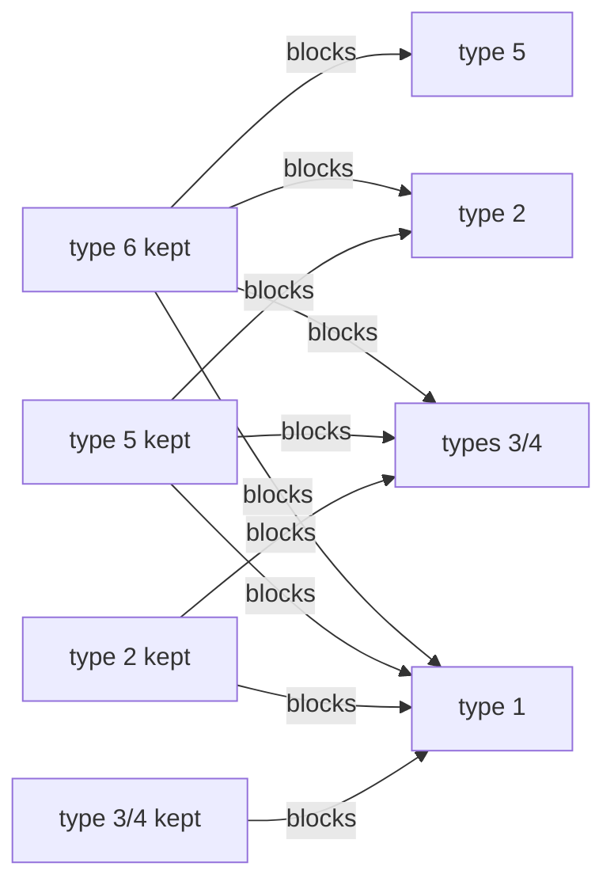

# NPC dialogue: choosing the line

Implementation: `crates/dq9-formats/src/dialogue.rs` (`parse`, `select`). Tool:
`cargo dq9re talk <archive> <member> [--step N] [--context N] [--talks N] [--night]
[--quest Q=quartet] [--hero-down]…` decodes the file and marks the line chosen for that
state.

## Loading

`TalkTask_Update` (`ov_017::021b8e8c`), state 0:

- archive `data/scenario/%s%c0.gp2`: `%s` = first three characters of the map name
  (`M02`), `%c` = `Scenario_ChapterLetter` (`ov_017::0218d2c4`) applied to the chapter
  (`Save_Chapter`, save `+0x5cb0`): `"ABCDEFGHIJSTKLMNOPQ"[chapter - 1]`, 1 to 19;
- member `%03d_<LG>.bin`: `NNN` = first `u16` of the NPC definition = identifier of
  field 0 of `<map>npc.bin` (see below). Check: 8,006 of the 8,461 English files
  have an NPC with that number in their map's `.npc`; the others belong to the field
  maps `F*` (which share `F.npc`) or are leftovers.

The application already used this naming rule, but initialized the triggers with
`1.1.1` even after loading a save: the demo in `C01M09`, progress `19.2.1`,
therefore looked for `C01A0` instead of `C01Q0`. It now restores the five tracks and their
flags, the global flags and the quest quartets from the save block; `Field::enter`
selects the room's track before the conversation. Variants of the same map family
keep the same three characters; this is not a fallback path search.
The track's progress chooses the letter, then its step and substep choose the
line. Explicit progress options replace the matching fields.
On a room change, the NPC cast is built from the **destination** track before
`Field::enter` selects that same track for triggers and conversations; the current
state is not modified while the cast is prepared.

Checks: demo save `19.2.1`, NPC 25 in zone 80: the browser opens
`C01Q0/025_en.bin`, record 0, and the line is displayed; save loaded before or
after the ROM. On `M01`, step 2, NPC 2: `M01A0/002_en.bin`, context 192, then the end of
the conversation fires event 1380. The priest's text ends with `<ADD>`; the religious
service that follows is not implemented.

The file (a record table, `table.md`) goes through `Talk_SelectLine`
(`ov_017::021ba810`), which rejects NPCs outside `0..=999`.

## Generic table reader (ARM9)

The table parser, searched for in vain until now, is at `0x02030644`–`0x02030b8c` (names
`Tbl_*` in `re/symbols.txt`). It receives an array `{u32 type; handler}` terminated by
type 0 (`Tbl_SetHandlers` sorts it by type), walks the records in file
order and calls `handler(fields, field_count)`, each field decoded as
`{type, value}`. Types without a handler are skipped. `Tbl_FieldInt` converts a
float to an integer and reads 0 for a string; `Tbl_FieldStr` returns 0 if the field is not
a string.

## Records

Handlers: `g_TalkLineHandlers` (`ov_017::021d7c58`). Two forms, depending on the number of
fields:

```
4 fields: a, b, slot, text
5 fields: a, b, night, slot, text
```

| Type | Function | `a`, `b` | Extra guard | Files (5 languages) |
|---|---|---|---|---|
| 1 | `TalkLine_Step` | min, max step (`a < 0`: always) | none | 80,450 |
| 2 | `TalkLine_Quest` | quest, condition | guest of a session: only quests > `0xad` | 90,430 |
| 3 | `TalkLine_SessionStepA` | min, max step | session active, local peer flag zero | 0 |
| 4 | `TalkLine_SessionStepB` | min, max step | session active, local peer flag non-zero | 12,810 |
| 5 | `TalkLine_HostStep` | min, max step | not a guest, hero word zero | 6,250 |
| 6 | `TalkLine_HostQuest` | quest, condition | like 5 | 0 |

- **Step**: `Save_ScenarioStep`, save `+0x5cb4`; requires `a <= step <= b`.
- **Quest**: 0 to `0xcb`; the save keeps one quartet per quest at `+0x2cc`: bits 0-1
  = state (`Quest_State`), bits 2 and 3 = flags. Condition `b`:

  | `b` | requires |
  |---|---|
  | -1 | state 0 |
  | 0 | state 2 |
  | 1 | bit 2 |
  | 2 | state 3 |
  | 3 | state 1 |
  | 4 | bit 3 and state 0 |
  | other | nothing (the `switch` has no default case; never encountered) |

  On George's quest 11 (`M02M0/018`): state 0 = not yet available, 1 = available
  (the conversation trigger then checks the level before offering the quest,
  `trigger.md`), 2 = accepted, 3 = completed. **[Names derived from texts and triggers.]**
- **Night** (5-field form, non-zero value): line skipped during the day
  (`Save_IsDaytime`, save `+0x3dc` non-zero). Once a night line has passed
  this test, all following **4-field** lines are skipped; 5-field lines
  with value 0 remain possible. The night texts ("Good evening", "Zzzz…")
  confirm the meaning.
- **Session**: `0x0202b7e8` (wireless session active), `0x0202c550` (active and local
  console ≠ peer 0, hence guest), `0x0202c1b4` (local peer byte at `+0x1038` of the session
  state) **[meaning unknown]**. **Hero word**: halfword at `hero->+0x130->+4`, the **hero's
  HP** **[supported hypothesis, `trigger.md`]**: types 5 and 6 require it to be
  zero, i.e. another member speaks in place of the fallen hero ("friend of
  `<HERO>`", silences of spirits that only the hero hears). `dq9re talk` assumes the hero
  is standing; `--hero-down` knocks them down.

### Slot (`Talk_SlotAccepts`, `ov_017::021b9bcc`)

`slot / 80` must equal `context / 80` (the conversation context, below);
then, with `t = slot % 80 / 16` and `n = slot % 16`:

| `t` | line kept if |
|---|---|
| 0 | `n <=` the NPC's conversation counter 1 |
| 1 | `n <=` counter 2 |
| 2, 3 | `slot == context` |
| 4 | `n <=` save `+0x5cb8` (`Save_ScenarioSubstep`) and `n >=` best `n` already kept (the largest wins) |

The two counters are per-NPC quartets in two 128-byte arrays
(`NpcTalkCount_Get`), both incremented (saturating at 15) after each successful
conversation. **[Difference between the two unknown: one may be reset on
map load.]**

The two arrays are at pointer `gameres+0x44c4` (the game resources), and two resets
are established:

- **New chapter or new step**: `Track_Advance` (`0x020703d8`, actions 0x84,
  0x94, 0xd6) calls `0x0206ec04` (zeroing of the 2 × 0x80 bytes) in both branches
  where the track changes chapter (`Track_ClearFlags`) or, within the same chapter, step
  (`Track_ClearStepFlags`), and only when progress moves forward. A new
  substep alone resets nothing. The counters are shared by the five tracks:
  advancing any of them clears them all.
- **Action 0x6a** (`Trig_RunAction` case 6, `0x02061c14`): `0x0206ecf8(table, NPC)` on
  each of the two arrays clears the quartet of NPC `arg` (byte `NPC / 2`, high quartet
  for an even number); a number ≥ 256 falls outside the array and errors (`0x0209954c`).

Observed slots: 0–3, 16–22 (group 0), 64–72 (test 4), 80–131 (group 1), 176–177,
192–223 (group 2, exact values).

### Choice

All lines are examined in order; the **last** accepted one wins, but
some acceptances block the following types:



Between quests (types 2 and 6, each with its own memory `g_TalkQuestLine`), a line
of quest `q` only replaces the one of quest `Q` already kept if `q == Q`, if `q` is
in state 1 or 2, or if `Q` and `q` are in state 3 with `q >= Q`. The memory is a
signed byte: a kept quest > 127 reads back as "none" (quirk preserved).

With no line kept, the conversation is abandoned.

Test `dialogue_selection_follows_quest_state`: George (`M02M0/018_en`) says "Those
betterflies are always hangin' about…" when quest 11 is accepted, "I suppose those
monsters…" when it is completed.

## Conversation context

Field `+0x124` of the conversation task. `Talk_Start` (`ov_017::021a4cf0`) first passes
the "talk to NPC" event to the **map triggers** (`trigger.md`) with the zone
computed by `Talk_NearestNpc` (`ov_017::021a4e88`): identifier of the NPC's **conversation
zone** that contains the hero (x/z rectangles attached to the NPC), 0 outside a zone.
The zones come from the type 6 records of `<map>place.bin`
(`[npc, x0, z0, x1, z1, id]`, `id` ∈ {0, 80, 192}).

- If a trigger applies, its actions run; action 0x76 starts the conversation
  with the context it carries (0, 80–131, 160, 176, 192–223). This is how the
  20,023 English lines (out of 37,988) of the exact slots 192–223 are reached
  (quest offers and rewards…).
- Otherwise, the context is the zone.

Two other callers impose `0xd7` and `0xc4`.

## `<map>.npc` (NARC)

Two record tables:

- `<map>npc.bin`, type 3: `[id, gender, Japanese name (Shift-JIS, often missing),
  model (n018a, s006…), ?]`.
- `<map>place.bin`: placement per room (`1200`… = room). Type 3:
  `[room, npc, x, y, z, angle]`; type 5: conditional placement; type 6: conversation
  zone; type 19: `[npc, .chr model, animation]`… **[to be documented]**.

## Partner: `Talk_NearestNpc` (`ov_017::021a4e88`)

Called with 1 by the action button (`Talk_FindPartner`, `ov_017::021a476c`, parameter `1`)
and with 0 without it. Decompiled and re-read on the European ROM (literal word constants
`0x021a51a0` = `0x3244`, `0x021a4cdc` = `0x1922`):

- **Candidates**: the NPC objects (32 slots). An NPC is a candidate when
  - **one of its conversation zones** (`place.bin` type 6, list `+0x40` of the placement
    node, in file order) contains the hero, **strictly** on x and z:
    `x < x_max ∧ z < z_max ∧ x > x_min ∧ z > z_min` (height is not tested); or
  - the hero is less than `0x1800` (1.5) from the NPC on x **and** on z. If the placement carries a
    type 20 record (`[f2, 0, f3, f1]`, `+0x5c` of the node), the center is offset by
    `(f2, f3)` and the range becomes `f1 + 0x1000` (distance range `f1 + 0x1400`).
- **Choice**: the angle between the hero's direction and the NPC's
  (`ov_017::021a4700`: `FX_Atan2` of the normalized difference, then
  `fix32SignedAngleDistance`, in absolute value) must be ≤ `0x3244` = **π** (`0x6488` =
  2π): no NPC is therefore excluded for its angle, only the one most **facing** the hero wins.
  A zone NPC is accepted as soon as its angle is no worse than the best already kept;
  a free NPC must in addition have a gender ≠ 1 (**"things to examine" can only be talked to
  from a zone**), be less than `0x1c00` away (1.75, `VEC_Distance` in 3D) and be
  strictly better than the best free NPC.
- **Context**: the identifier of the kept NPC's zone, 0 for a free NPC.
- The object flags (`0x200`…) and the "hero busy" state (`func_020535c8`…) exclude
  other cases: **not modeled**.

`dq9_core::talk::nearest` reproduces these rules, with two deviations: the 1.75 distance is
measured on the ground (the application's NPC heights are those of the placements, not
re-snapped), and `local_b4` (the distance range) is not kept from one NPC to the
next (the game does not reset it in its loop: an NPC with record 20 widens
the range of the following ones, a quirk not reproduced). No `port:` marker: the function
is not fully reimplemented. Tests `the_partner_is_in_range_and_the_most_faced` and
`zones_give_the_context_and_things_need_them` (synthetic data).

### Starting the conversation (`Talk_Start`, `ov_017::021a4cf0`)

The kept NPC is stored in `GameState+0x5724`, then `Trig_Fire(event 0)` receives
`[0] = NPC`, `[5] = context`. No trigger holds (`Trig_Fire` returns 0): the conversation
task starts with the zone's context. A trigger holds: only its deferred actions
run, and it is action `0x76` that starts the conversation (with its own
context). `dq9_core::field::Field::talk` returns `NoTrigger`, `Fired(events)` or
`Unsupported(condition)`; the application starts the conversation on `NoTrigger` and on a
`Request::Talk` of the NPC, and forwards the other events (map change, requests
unsupported before the `.stb` interpreter).

### Turned to the hero (`<N_TURN>`, `<END_R_TURN>`, `<R_TURN>`) and the balloons

Re-read on the European ROM (`0x0206a3d0`, `0x020656f4`, `0x02040b00`, `0x0203c828`,
`0x02041388`, `0x02033844`, `0x02033720`, `0x0206760c`; the corpus addresses are the USA ones
of the decompilation, EU = USA + `0x10`).

Two different turns hide behind the same tag family, and the batch's original wording
("`func_02033834` turns the partner") conflated them: `Character_SetFacing` turns the **hero**
once at the open, the message window turns the **partner** at every message, and each
representation the partner can be drawn with steps at its own rate.

**Opening the conversation** — `TalkTask_Update` (`ov_017::021b8e8c`), state 0:

- the leader is `GameState+0x397c` (`GetUnknownGameObject`, `map-archive.md`); its walk speed
  `+0xb2` is zeroed and `func_020397cc(obj, 1)` runs on it;
- the partner's character is looked up (`func_0203cf4c` = character table,
  `func_0203df78(table, npc)`, position `func_020406f8`), the angle from the leader to it is
  `fix32ReduceAngle0To2Pi(FX_Atan2(dx, dz))`, and `Character_SetFacing`
  (`0x02033844`) turns the **leader** to the partner;
- the message window keeps the partner's character id (`+0x1838 =
  func_0203dfdc(table, npc)`) and its current angle (`+0x183c = func_02040a90(chara)`).

Nothing here touches the partner's own motion: only the leader's speed is cleared, so a cast
member that wanders is not stopped by the talk task **[fact from the code; the visible
stillness of a wandering NPC during a conversation is not observed]**.

**At the start of a message** — `Msg_ConsumeLeadingTags` (`0x0206a3d0`), before the text is
compiled:

| Tag | Effect |
|---|---|
| (none) | `+0x1844 = ReduceAngle(FX_Atan2(leader.x − npc.x, leader.z − npc.z))` — the angle **from the partner to the hero** — and `+0x19b6 = 1` |
| `<N_TURN>` (`0xFF2B`) | `+0x1844 = +0x183c` (the angle saved at the open) and `+0x19b6 = 0`: this message does not turn the speaker at all |

The tags are consumed per message, so each page's own leading tags decide. English text:
6,638 `<N_TURN>`, all leading (the table also counts 312 `<EXC>` and 51 `<QES>`, of which only
2 and 0 are leading: the others are mid-message codes of the interpreter).

**Per window update** — `func_020656f4` (`0x020656f4`): while `+0x19b6` is set it gives the
partner `+0x1844` as its **requested** angle (`func_02040af0(chara, angle)`) and compares the
two angles `func_020409e0` and `func_02040a20` read back (`+0xb0`/`+0x2d4` against `+0x54` for
a model, `+0x64` against `+0x60` for a sheet), returning 1 while they differ and clearing
`+0x19b6` on arrival. `func_02040af0` (`0x02040b00`) writes the representation's request, not
a shared field: `+0x64` of the 2D sheet (chara `+0x14`, `func_0203cdd8`), `+0xb0` of the
Object3D (chara `+0x18`), `+0x2d4` of the game object (chara `+0x1c`).

**The steps**, one per representation (`func_02040c2c` dispatches on the chara, called from the
NPC update `func_0203dd20` at the field's 30 Hz cadence, `docs/architecture.md`):

| Drawn as | Step | Code |
|---|---|---|
| 2D sheet (`NpcSprite`, chara `+0x14`) | `+0x60` towards `+0x64` by `+0x68 = 0x324` × `GetTickCount()` (2 on the field) = `0x648` per update, 0.39 rad | `func_0203c818` (`0x0203c828`), rate stored by `func_0203c794` (`0x0203c7a4`) |
| model (chara `+0x18`) | `+0x54` towards `+0xb0` by the constant `iRam0204147c = 0x333` per update, **not** multiplied by the tick count, 0.20 rad | `func_02041378` (`0x02041388`) |

Both stop exactly on the request and wrap with `fix32ReduceAngle0To2Pi` (`0x6488` = 2π, 4096
per radian). A model therefore turns at about **half** the sheet's rate: a half turn takes 8
sheet updates (0.27 s) or 16 model updates (0.53 s).

`Character_SetFacing` (`0x02033844`) / `Character_TurnToFacing` (`0x02033720`) are the
**hero's** path, used by `TalkTask_Update` at the open and by `Character_Update`
(`0x020332bc`, `dq9_core::movement`): `+0xae = ReduceAngle(angle)` (kinds 3 and 4 also snap
`+0x54`, `func_02033874`), then `+0x54` towards `+0xae` by `*(short *)(obj + 0xb0) ×
GetTickCount()`, `Character_Init` (`0x02032e68`) leaving `+0xb0 = 0x324` — the same rate as a
sheet. Kinds 4 and 6 skip the step; on arrival with bit `0x8000` of `+0xc4` set, kind 0 and
the model name `uRam02033840`, animation 0 starts (`func_02033b88`).

**Closing**: the heading is given back only when the line asks for it.
`MsgWin_Update` (`0x020659a0`), state 0, compares the current control code with `0xFF02` and
then calls `func_02040af0(chara(+0x1838), +0x183c)`; `0xFF02` is `<END_R_TURN>`, and
`<R_TURN>` (`0xFF2C`) does the same through the code-runner. A plain `<END>` (`0xFF01`)
restores nothing: the partner keeps the heading the turn left it at. English text:
5,903 `<END_R_TURN>` against 30,625 `<END>`; 1,016 `<R_TURN>`.

**Port.** `AnimatedScene::turn_npc` / `turn_npc_toward` / `release_npc` / `npc_angle`
(`crates/dq9-render/src/animation/facing.rs`) keep one pivot per NPC id: a sheet turns
`0x324` per 60 Hz step, a model `0x333` every second step (the field's 30 Hz update), the
short way round `0x6488`, stopped on the target and held, with the heading the pivot found
kept for `release_npc` (which turns back smoothly, like `func_02040af0`). A pivot re-requested
after a plain `<END>` close re-saves that conversation's opening heading, as
`TalkTask_Update` re-saves `+0x183c` at every open. A script
writing the heading (`set_npc_angle`, the event natives) ends the pivot. `Talk::face_partner`
(`crates/dq9-app/src/talk.rs`) requests it each step for the open partner, does not request it
when the page carries `<N_TURN>`, and releases at the close when the line carries
`<END_R_TURN>` (the port's compiler maps `0xFF01` and `0xFF02` to one end, so the raw text
decides, as for `<INN=n>`). `<R_TURN>` is **[unknown]** in the port: it restores the heading in
the middle of a message, which the port does not report; no prologue conversation depends on it
**[hypothesis]**. The `--screenshot` preview steps the same pivots
(`AnimatedScene::step_turns`), so a capture shows the turn.

Captures (`build/evidence/v3-dialogue-cast/`, M01, story 1.2.1, hero at `(-25.0, 3.72)`, horse
NPC 4 at `(-23.68, 3.72)` facing `+x`): `m01-horse-before.png` (`959101d22f1f`) the horse facing
`+x` with no window; `m01-horse-after.png` (`680b4cbdc433`) the first window of "Neigh!"
(`004_en.bin`, record 0, `<END>`), the horse turned round to the hero and holding;
`m01-horse-closed.png` (`d52afcffb35f`) after the close: it keeps that heading, since the line
ends with a plain `<END>`. No NPC of M01's story-1.2.1 cast carries `<END_R_TURN>` (M01 has
two elsewhere, NPC 102 `M01A0/102_en.bin` and NPC 108 `M01A0/108_en.bin`, one a sheet and one
a model), so the return is unit-tested instead
(`a_release_turns_back_and_a_script_takes_the_npc_over`,
`a_new_conversation_saves_the_heading_it_finds`).

**Balloons** — the two tags are control codes pushed into the stream and handled by the
window, not by the leading-tag consumer:

| Tag | Leading form (`Msg_ConsumeLeadingTags`, `0x0206a3d0`) |
|---|---|
| `<EXC>` (`0xFF2E`) | `+0x1959 = 0x3c` (60 ticks), `+0x19b7 = 1`, `+0x195c = 0`, sound 6 |
| `<QES>` (`0xFF2F`) | same, `+0x195c = 1`, sound 0x1c |

Inside a message the same codes reach the interpreter (`MsgWin_Update` `0x020659a0`), which
raises the same 60-tick timer (`docs/re/sdat.md`). Counts: 312 `<EXC>` and 51 `<QES>` in the
English text, 2 and 0 of them leading.

`func_02065758` counts `+0x1959` down by the tick delta and clears `+0x19b7` at zero. The draw
is `func_020675fc` (`0x0206760c`):

- the partner's character (`+0x1838`) must exist and `+0x19b7` be set;
- its position (`func_020406f8`) goes through the field projection `func_0202ec84`, then the
  sprite is placed at `(−12, −62)` pixels from it;
- the sprite index is the byte `*(u8 *)(0x020e7e18 + kind)`: `0x0d` for `<EXC>`, `0x0e` for
  `<QES>` — the two entries of the field sprite bank at `gameres + 0x2b90` (stride `0x88`,
  `SPRSprite`), loaded by `ov_017::0219b624` from `data/bin/icon.nsarc` through the table at
  `0x021d656c` (`{"ARC:%s", …}`): **13 `ev_mark.spr` (the "!"), 14 `field_qu.spr` (the "?")**;
- `SPRSprite::DrawAnimatedNoRotation(sprite, 1)`.

The port does not draw them yet **[unknown: no capture, and the balloon needs the speaker's
screen projection]**: the request is not kept by `dq9-core` (the codes only play their sound,
`Sound::Exclamation`/`Question`) and `Talk` has no camera to project the speaker. The sheets
are already known to the event layer (`field_sprite`, natives 541/542/561,
`docs/re/stb-natives.md`).

## Message window

Sources: `MsgWin_Show` (`0x0204501c`), `MsgWin_Update` (`0x020659a0`, the interpreter of
`0xFFxx` codes), `MsgWin_WrapLines` (`0x0206b984`), `MsgWin_ParseSpeakerName`
(`0x0206ad84`), `Msg_ConsumeLeadingTags` (`0x0206a3d0`), `MsgWin_LoadFrames` (`0x0202f25c`);
Text-Markup wiki (USA addresses, checked one by one on the EU ROM: EU = USA + `0x10`).

### Geometry (256 × 192 screen)

| Fact | Source |
|---|---|
| window `(x, y, w, h) = (2, 0x74, 0xfc, 0x4a)` = `(2, 116, 252, 74)`; 3 lines (`+0x9a4 = 3`, `<GYOU=n>`) of 20 pixels (`+0x1864 = 0x14`), font cell 12 × 16 (`<MOJI=w,h>`) | `MsgWin_Show` (`MsgWin_SetRect(win, 2, 0x74, 0xfc, 0x4a)`) |
| frameless variant: rectangle `(2, 0x92, 0xfc, 0x4a)`, `+0x19b1 = 0` | `MsgWin_SetFramelessRect` |
| frame = **8 pieces 8 × 8** `data/ani/win0..7.spr`: top-left corner, top edge, top-right corner, right edge, bottom-right corner, bottom edge, bottom-left corner, left edge; 4-color palette per piece, index 0 transparent | `MsgWin_LoadFrames` (`sprintf("ARC:win%d.spr")`), file contents |
| each piece has a one-pixel transparent margin: they are laid **every 6 pixels** (edges) under the corners | patterns of the 8 files |
| name plate (`//Name//`): width `a + 26 − (a & 7)` with `a` = name advance (sum of `width + 1`), height 22 | `MsgWin_ParseSpeakerName` (`+0x934`, `+0x936`) |
| `<CEN>`: byte `+0x19b8`; `<WIN>`: `+0x19b1 = 0` (frame not drawn); `<RECT=x,y,w,h>`: rectangle (x ≤ 256, y ≤ 192, negative w and h → rest of the screen); `<COLOR=r,g,b>`: text color in BGR555 (components clamped to 255, negative → 255); `<SKIP>`: `+0x19bb = 0` | `Msg_ConsumeLeadingTags` |

**[Hypotheses, not read]**: text margins inside the window (12 and 10 pixels), wrap
width (228), plate position (6 pixels from the left edge, 4 pixels of overlap),
position and size of the Yes/No window, background color (translucent midnight blue), choice of
`arrow2.spr` for the wait arrow, exact meaning of `<CEN>` (box vertically centered,
lines centered: `MessageCountLines` multiplies `lines − 1` by the line height to
center the window). A capture of a window in melonDS has not been done: these choices are
to be corrected from a capture, they are constants of `dq9-app/src/talk.rs`.

`*:` is **not** removed from the stream: it is drawn (glyphs `*` of 7 pixels then `:` of 1
pixel from the font). `MsgWin_ParseSpeakerName` looks for `//`, `*:` and `*<:>`: with `//`, the name
and the following space are skipped; with `*:` only byte `+0x912` is set to 3 (the window's
arrow counter: 3 draws the wait arrow, 5 hides it, § "Message pacing"). The name is read on
each page: it appears after `<PAGE>`
(`//Cap<1>n Max Meddlin//` …).

### Layout (`MsgWin_WrapLines`)

Glyph advance = kerning + width + 1; a space = space width + 1. When the
next glyph would exceed the width (`max_width < x + kerning + width`) and a
break has been seen, the line is broken at the **last break** — after a space (which
disappears) or after a `-` glyph — and the rest moves to the next line. With no possible
break, the word overflows. `\n`, `<PAGE>` and `//…// ` reset the position to zero.
The fourth line of a page **scrolls** the window (`+0x19b4`, `+0x1868`): `+0x1868 += ticks` per
update up to the line height `+0x1864 = 20`, then `func_0206b61c` (EU `0x0206b62c`), without
waiting for a button: 10 updates of 2 ticks, i.e. **one pixel per 60 Hz step** (the tick source
is read, § "Text speed"). `dq9-core` waits `SCROLL_STEPS = 20` steps, then moves the lines up at
once (no smooth scrolling).

### Codes and wait states (`+0x9a0`)

| Code | Effect read in `MsgWin_Update` |
|---|---|
| `0xFF01` `<END>`, `0xFF02` | state 0: the text stays, the game waits for the button then closes |
| `0xFF03` `<CLOSE>` | state 0 then immediate close (`func_02043204`, `func_02043124`) |
| `0xFF0A` `<ADD>` | state 3: the window stays for the scene's next message **and waits for the key** (the wait arrow blinks, no timer): see § "Message pacing" |
| `0xFF0B` `<AUTO=n>` | state 4: `MsgWin_StepAutoPage` counts `n` ticks (`+0x195f`) then the next page starts by itself; **not modelled** (no text of the prologue carries it; the only code that advances without a key) |
| `0xFF0C` `<PAGE_T=n>` | state 1 (arrow) with `+0x1961 = n`; `MsgWin_PollWaitKey` counts it down by `GetTickCount` and acts as the key at zero (`n` ticks = `n` 60 Hz steps). `Op::Timeout(n)` + `Op::Page` |
| `0xFF0D` `<PAGE>` | state 1: wait for the button (arrow), then the page is cleared |
| `0xFF1A` `<TIME=n>` | counter `+0x186c + 4 × slot` (added by `func_020457e8`), **decremented once per `MsgWin_Update` call** (33 ms): `n` updates = `2n` steps. 1009 of the 1027 uses are `<TIME=180>` (quest-complete banner: 6 s, not 3 s) |
| `0xFF1D`, `0xFF1F` | state 2: wait for the button (with / without the cursor, `+0x19ca`) |
| `0xFF1E` `<PAD_T=n>` | no state: the counter `+0x186c + 4 × slot` drops once per update and the code stays current until a key is pressed or it reaches zero: `2n` steps. `Op::Timeout(2n)` + `Op::Wait` |
| `0xFF04`–`0xFF07`, `0xFF08` | state 6: choice; `0xFF05` (`<NOYES>`) places the cursor on No; answer in `+0x954` (up/down move, A confirms, B cancels = −2) |
| `0xFF14`–`0xFF17` | **no handler** in the interpreter: plain markers |
| `0xFF26`/`0xFF27`, `0xFF28`/`0xFF29` | `+0x19b1` (frame) and `+0x19b8` (centering) |
| `0xFF2A`…`0xFF2F`, `0xFF0E`, `0xFF10`–`0xFF13`, `0xFF34`–`0xFF48`, `0xFF4B`… | NPC turns, balloons, shake, quests, sounds: **not modeled** |

Choice sounds (details and evidence in [`sdat.md`](sdat.md)): opening, effect 5; answer,
effect 1, except `<YESNO_NOTSE>` (`0xFF06`, no answer) and `<YESNO_NOTSE_IIE>` (`0xFF07`,
second answer); B is silent. Moving up/down plays no effect.

**The `<YES>`/`<NO>` markers are jump targets [supported hypothesis]**: the interpreter
ignores them in linear reading, and the texts alternate their branches (`<YESNO><YES>A<END>
<NO>B<END>`, `<YESNO><NO>B<END><YES>A`). After the answer, `dq9-core` resumes reading
**after the first marker of the answer that follows the question**, the box cleared; with no marker,
it resumes at the next `<END>`. `<JP_x>` jumps after `<LB_x>` (the engine searches for the
code `0xFFD0 + n` in the whole stream): some questions repeat this way ("Do you want
an explanation?"). Real test `every_npc_line_plays_to_its_end`: the 37,988 English
lines (all the lines of `<map><letter>0.gp2`) compile, lay out and
play until closing, answering Yes and No in turn (775 display no
glyph: `<END>` alone, `<ADD>`…).

### Message pacing (`j4-message-flow`)

Reported: in Aquila's and Apus Major's scenes "some messages wait for A, the others chain by
themselves", and a Yes/No answer needed two presses. Evidence is local
(`build/evidence/j4-message-flow/`, sha256 prefixes in the manifest).

**What ended a message in the port, before.** Our run of the new game's opening
(`print_message_table`, `before-new-game.txt`): of the 22 messages that are not timed captions
(events 21500, 21507, 21520, 21522, 21596 within 20,000 steps), the **11** ending with `<ADD>`
(Aquila's "You have come far…", "These wicked creatures…", "Behold… Benevolessence.", Erinn's "don't be so
melodramatic", the two of 21596…) closed **by themselves 27 to 122 steps after their show**, and the
next opened 4 to 5 steps later; only `<END>` ones waited for A. 43 of the 112 messages of stage
1.1 (`dq9re script 1.1`) end with `<ADD>`. Apus Major's welcome (event 1160, `before-event-1160.txt`)
was eight `<ADD>` messages and a question, each closing 42 to 124 steps after its show.

**What the original does** (read in `MsgWin_PollWaitKey` `0x020440dc` and `MsgWin_Update`
`0x020659a0`, then measured in melonDS, `scripts/melondsds_host.py --state-in
build/v01-20261107/oracle/talk127b-state.bin --watch 0x021152f4:0x1a00`, event 1170's "Apus Major
has sent you…?<ADD>" followed by "Then you may pass."):

| Message ends with | Window state `W+0x9a0` | Leaves it when | Then | Read / measured |
|---|---|---|---|---|
| `<ADD>` (`0xFF0A`) | 3 | **the key**; no timer | `W+0x19bd` (native 405) = 0 **at once** (case 3); the next 400 types in the same window 2 frames later | `MsgWin_PollWaitKey` case 3. State 3 held for 330 frames without input; key at frame 100: `+0x19bd` 1→0 at 101, next text typing (`+0x9a0` 5, `+0x19bd` 1) at 103. Draws the blinking wait arrow (§ below) |
| `<END>` / `<END_R_TURN>` or no tag at all (the stream buffer is filled with `0xFF01`, **[hypothesis]** for "no tag") | 0 | the key | `+0x1958 = 5`, minus 2 per update: closes (`0x02043214`, `+0x19bd` = 0) **6 steps** after the key | key at frame 61, closed at frame 67: absolute frames of one capture, 6 steps between them; key 840 → 847 (1-frame pulse). `CLOSE_STEPS` |
| `<CLOSE>` | 0, closed in the same call | nothing | `0x02043214` + `0x02043134` at once | `MsgWin_Update`, code `0xFF03` |
| `<PAGE>` | 1 | the key | next page types | already modelled |
| `<PAGE_T=n>` | 1 | the key or `n` ticks | idem | `+0x1961` counted by `GetTickCount` (2 per update): `2n`... already modelled |
| `<PAD_T=n>`, `<TIME=n>` | none / counter | key or counter | idem | already modelled |
| `<AUTO=n>` | 4 | `n` ticks, no key | next page starts | `MsgWin_StepAutoPage`, **not modelled, no text carries it** |
| `<YESNO>` etc. | 6 | the key (A), or B | the answer callback (`0x020678cc`) jumps to the answer's marker (typing, state 5) | modelled; see below |

**The wait arrow** (`W+0x912`). The down triangle is drawn in wait states **1 (page), 2 (pad)
and 3 (`<ADD>`)** and not in state 0 (`<END>`) nor 4 (`<AUTO>`): it depends on the state, not on
the text. In those three states it is hidden for the state's first 10 frames, then drawn 32
frames and hidden 32 (`+0x912` 3 then 5: visible 10-41, hidden 42-73, visible from 74, frame
counted from the state's start). The `talk127b` capture at frame 60 read `+0x912 = 5` because it
fell in an off phase, not because state 3 draws nothing. Measured at about (128, 183) on the
bottom screen (375 on the stacked two-screen capture; the window's horizontal centre) by
`j4-message-arrow` (`build/evidence/j4-message-arrow/`, challenger states
`build/scratch/challenger-msg/run/`, `s3.png`). The port's `View::arrow` follows the states and
the blink; the sprite (`arrow2.spr`) and the corner position of `dq9-app` stay **[hypothesis]**
(a bigger triangle at the window's right, where the original's is small and centred). States 0
and 4 draw none.

The wait-for-key states take A, B, X (mask `0x403`), L and R (`0x200`/`0x100`, written to
`+0x19bf`/`+0x19cf` by `MsgWin_Show` `0x0204501c`) and the four d-pad keys (`0xf0`); Y, Start and
Select do nothing. **Touch is not established** (an earlier note fitted the stylus test
`object+0x54 != 0 && +0x44 < 20`; taps on the bottom screen did not leave a wait). The test is
an **edge**: `TestKeysPressed` (`0x02012454`) is `cur & m && !(prev & m)`, so a held key
advances once. The port maps `Enter`/`Space`/`Z` (A), `Backspace`/`X` (B), `C` (X), `Q` (L),
`E` (R) and the arrows or `W`/`A`/`S`/`D` (d-pad) onto `dq9_core::talk::Input` (`advance` for
X, L, R and the left/right d-pad; A, B and up/down through their own fields, which also leave a
wait); A and B also answer a prompt, up/down move its cursor. Caveat for the captures: a
1-frame press only registers if it lines up with the original's update cadence (the field
updates every second frame); a key held 4 frames always registers.

A message **advances by itself only** through `<CLOSE>` (closes at once), a timer code
(`<PAGE_T>`, `<PAD_T>`, `<TIME>`, `<AUTO>`), or the script's own native 401 after its wait loop
(the `<CEN>` captions: the script counts, 400 → 401 in the same tick, `docs/re/stb.md`).
Everything else waits for a key. There is **no pause between two consecutive messages** other
than the key's latency (`<ADD>` 1 frame + the script's poll of 405 every 2nd step; `<END>` 6
steps + the poll) and the typing of the next. The numbers are exact for the port (the 11 `<ADD>`
messages of the opening now need one press each; `after-new-game.txt` and `after-event-1160.txt`
show 5-6 steps from the key to the next message).

**Yes/No answers.** The answer callback (`0x020678cc`) calls `0x0206b2d8` with the answer's
marker: the search (`0x0206aca4`) **finds a `<YES><END>` branch**, moves `+0x54/+0x58` to the
marker and sets `+0x6c = 4`. The close comes afterwards, in the page-preparation function
`0x0206aa38` (`func_0206aa28` in the decompiler): it calls `0x02043214` and `0x02043134` when a
terminator code is reached before any glyph, so **an `<END>` on an empty page closes the
window** — NPC 130 of `X01M07`: key at frame 795, `+0x9a0` 6→0 and `+0x998` 1→0 at frame 797,
then event 1600 at frame 829. A branch **with text** types it, needs a **second** key, then
closes 6 steps after it (the same NPC's `<NO>` branch: 6→5, types, waits at state 0,
`CLOSE_STEPS`). A question whose text has **no** marker at all (Apus Major's message 210, and
native 558's cases: ev01160, ev02210 ×2, ev02535, ev02800, ev02940) finds no branch and closes
on the single press too (`+0x9a0` 6→0, `+0x998` 1→0). The port implements both: a prompt
without a marker closes at once, and a branch whose first code is `<END>` closes when that code
is read with no glyph typed.

**Port** (`dq9_core::talk::Dialogue`): `State::WaitAdd` (the key, the blinking arrow, no timer,
then `Closed(Add)`), `State::Closing(CLOSE_STEPS)` after an `<END>` key, and a prompt without a
marker or with an empty branch closing at once. Tests
`an_add_message_waits_for_the_action_key_and_the_next_one_follows_it`,
`one_press_answers_a_yes_no_question_and_the_scene_goes_on`,
`one_press_answers_a_conversation_question_whose_branch_is_empty` (real ROM, presses through
`App::key`; each failed before: the first closed the ADD message by itself 112 steps after
the show, the others left an arrow after the answer), the unit tests
`the_wait_arrow_blinks_32_on_32_off_in_states_1_2_and_3`,
`a_wait_leaves_on_the_advance_edge_and_a_held_key_does_not_touch_the_next_one` in
`talk/tests.rs`, and the key map in `crates/dq9-app/src/app/input.rs`. The window is not kept
on screen between an `<ADD>` message and the next (the original keeps the
text up for the 2 frames of the script's poll; ours shows the box empty for 4-5 steps).

### Text speed

**Measured and read on the European ROM** (`j4-text-speed`; evidence local, never committed).

*Tick source.* `MsgWin_Update(window, ticks)` (`0x020659a0`) is reached through the trampoline
`0x020444e4`, called from two places only: the field task `ov_017::0218cbd4` (call at
`ov_017::0218cd68`, `r1 = [sp+0xc]` = `GameState::GetTickCount()` read at `0218cc10`), and the
battle `ov_019::0218bfb4` (`r1 = 1`). `GetTickCount` is `numTicks_` (`GameState+0x3c4`, `0x02010230`),
2 on the field's 33 ms updates (`stb-natives.md`, native 840). The update runs **every 2nd
frame**, with 2 ticks.

*Typing.* `+0x80 += ticks × 0x10`, units revealed = `(new >> 4) − (old >> 4)` = `ticks`
(`0x02065c64`..); `+0x19c5` (cleared by `MsgWin_Show`, `0x0204501c`, no setter found in the
code the field and `MsgWin_Show` run) and the timed caption (native 409, `+0x195b & 4`) force 16
and 24 units per call. A *unit* is one 16-bit code of the compiled stream: each glyph, each
space `0xFF19`, each line break `0xFF18` (a break replaces the space it wraps at) and each
code whose handler does not return (`<EXC>`, `<QES>`, `<YES>`… markers, labels, `<ME_n>`…): the
loop decrements its budget `iVar2` once per code (`LAB_02066a4c`). Codes that stop the
interpreter (page, wait, pause, prompt, end) spend none. **No setting scales it**: the update
reads no option, and there is no message-speed entry in the strings of the game's menus
(`dq9re text`, English, 51,089 strings, only the dialogue "slow" hits). `<W=n>` appears 5
times, only in `data/bin/menu/*` records, never in a message window text. There is no
punctuation pause: the rate is constant over "Hmph! Thanks, …!".

*Capture.* `scripts/melondsds_host.py` (libretro melonDS), `--state-in build/orca/route/idle-state.bin`
(the observatory cutscene, event 1600, window `W = 0x021152f4`), pad A held frames 61-66 closes
the previous page, `--watch W:0x1a00`; per-frame values reconstructed from the byte changes:

| frame | `+0x78` index | `+0x80` | `+0x9a0` state |
|---:|---:|---:|---:|
| 113 | 0 | 0 | 5 (typing starts) |
| 118 | 2 | 160 | 5 |
| 120 | 4 | 192 | 5 |
| 122 | 6 | 224 | 5 |
| 124 … 176 | +2 every 2 frames | +32 | 5 |
| 176 | 60 | | 5 |
| 178 | 61 (the end code `0xFF01`) | | 0 (waits for the key) |

= **2 units every 2 frames, 1 unit per frame, 60 units per second**, for a 61-unit line (50
glyphs, 10 spaces, 1 break; the stream was read from RAM, `+0x4c`, 64 codes).
`build/evidence/j4-text-speed/trace-idle.txt` (sha256 prefix in the manifest). Pressing A
again at frames 130-133, in the middle of the typing, gives **an identical trace**
(`trace-a-during-typing.txt`, same 178-frame end): **the action key does not skip the typing**.
That is also the code: `MsgWin_PollWaitKey` (`0x020440dc`) switches on the wait states 0-3 and has
no case for state 5, where the update types.

**What the port does** (`dq9_core::talk`, `speed.rs`): one unit per 60 Hz step at
`TextSpeed::Normal`, the original's rate and the default; `Slow` (0.5×) and `Fast` (2×) are a port
option (`--text-speed`, `?textspeed=`). The key no longer skips a page (it used to type up to the
next wait, **wrong**: a second press while a page types showed the page at once, **[hypothesis]**
the most likely cause of "too fast"). Spaces, breaks, markers and sound codes cost a unit (before,
only glyphs did: 11 units of 61, 18 %, on the captured line). `<TIME=n>` lasts `2n` steps (was `n`), `<PAGE_T=n>` and
`<PAD_T=n>` end by themselves. Unit test `a_captured_line_costs_the_units_the_original_spent`
reads the captured line from the ROM (event 1600, third text, a five-letter name) and asserts the
61 units. Codes the port does not model (NPC turns, quests, `<ALL_RECOVER>`, …) still cost 0
(the original: 1 each) **[unknown whether any is mid-text]**; the battle window (ticks 1) is not
played by `Dialogue`.

## Implementation

- `dq9_formats::message::leading_tags`: leading tags (`Msg_ConsumeLeadingTags`).
- `dq9_core::talk`: `nearest`, `TalkCounts` (`NpcTalkCount` counters, the map's reset
  on entering a map, all of them by `Track_Advance` on a new chapter or a
  new step, an NPC's by action 0x6a; carried by `trigger::State::talk_counts`),
  `compile_message`/`layout`/`prepare` (the six passes with
  the hero's identity — name and gender taken from the save, otherwise male "Hero" —
  and the gender/solo conditions, then layout), `Dialogue::step` (one button per fixed
  60 Hz step; the text reveals `TextSpeed::units` message units per step, `Dialogue::set_speed`)
  and `Dialogue::view`. `Talk::set_text_speed` (`dq9-app`) applies the option to the dialogues
  opened afterwards (`--text-speed slow|normal|fast`, `?textspeed=`; hooks in the batch report).
- Hero identity: `dq9-app` reads it from the save's current slot
  (`Save::current_slot`) and from the first party character (index `standby_count`),
  like the hero model: name `+0x140` as glyph indices of the message font,
  gender `+0x174` bit 0 (0 male, 1 female, `characters.md`). `Talk::set_identity` rebuilds
  the `Names` from the glyph text, so `<HERO>`, `<LEADER>` and `<ADDRESSEE>`
  carry the player's name and `<IF_HERO_MALE>`/`<IF_MALE>` follow their gender. Without a save,
  for a new game or after a replaced save (Web reload), the default identity
  male "Hero" comes back. Checked on the bytes of the demo save
  (`save.md`): record `standby_count` 0, the indices of `+0x140` decode to "Adenine"
  in `fi_me.bin` and `+0x174` bit 0 is 1.
- `dq9_render::ui`: atlas (font in alpha, frame pieces, arrow), quads in DS pixels,
  wgpu pipeline drawing over the finished 3D image, in the largest 4:3 of the target.
- `dq9-app/src/talk.rs`: line choice (`<map><letter>0.gp2`, `NNN_en.bin`,
  `dialogue::select` with the trigger state: step, substep, quests, day/night), window,
  name plate, Yes/No window, the blinking wait arrow; inputs `Enter`/`Space`/`Z` (A),
  `Backspace`/`X` (B), `C` (X), `Q` (L), `E` (R), the arrows or `W`/`A`/`S`/`D` (d-pad);
  `--input` for captures.

## Remaining

- Balloons `<EXC>`/`<QES>`: the rule, the 60-tick wait, the sheets (`ev_mark.spr`,
  `field_qu.spr` of `data/bin/icon.nsarc`) and the draw (`func_020675fc`) are read (§ "Turned to
  the hero"); the port neither keeps the request nor projects the speaker, so nothing is drawn.
- `<R_TURN>` (`0xFF2C`) mid-message: restores the saved heading in the game, not reported by the
  port's dialogue.
- The heading a conversation leaves behind is **not** restored by a plain `<END>` (§ "Turned to
  the hero"): the partner keeps facing the hero until a script or a cast rebuild moves it.
- Services (`<INN=n>`, `<SHOP=n>`…), quests (`<QUEST=n>`), sounds, shake, `<AUTO>`,
  `<ALL_RECOVER>`.
- The layout constants above to be confirmed on a melonDS capture; the language
  is English (`NNN_en.bin`), the hero's name comes from the save's current slot
  (default "Hero" without a save); `<IF_…>` conditions other than gender/solo take
  their first branch.
- `<TC#>`, `<PLTT=#>`, `<W=#>`, `<CURSOR=#>`, `<TRI-L/R>`, `<LG>`: counted in the English
  texts (`dq9re text --lang en`), `<TC…>` and `<TRI…>` never appear there, `<PLTT=>`
  4 times, `<CURSOR=>` and `<LG>` once, `<W=>` 5 times, all in menu strings
  (`profstr`, `str_bres`, `str_da12`…): off the path of NPC lines and of the
  prologue's event texts, not supported; the leading tag actually used
  by the prologue is `<CEN>`.
