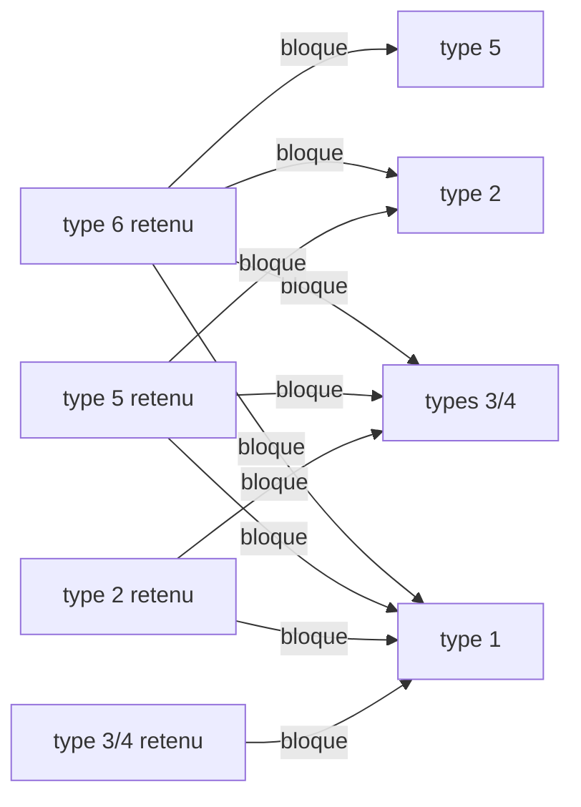

# Dialogues des PNJ : choix de la réplique

Implémentation : `crates/dq9-formats/src/dialogue.rs` (`parse`, `select`). Outil :
`cargo dq9re talk <archive> <membre> [--step N] [--context N] [--talks N] [--night]
[--quest Q=quartet]…` décode le fichier et marque la réplique choisie pour cet état.

## Chargement

`TalkTask_Update` (`ov_017::021b8e8c`), état 0 :

- archive `data/scenario/%s%c0.gp2` : `%s` = trois premiers caractères du nom de la carte
  (`M02`), `%c` = `Scenario_ChapterLetter` (`ov_017::0218d2c4`) appliqué au chapitre
  (`Save_Chapter`, sauvegarde `+0x5cb0`) : `"ABCDEFGHIJSTKLMNOPQ"[chapitre - 1]`, 1 à 19 ;
- membre `%03d_<LG>.bin` : `NNN` = premier `u16` de la définition du PNJ = identifiant du
  champ 0 de `<carte>npc.bin` (voir plus bas). Contrôle : 8 006 des 8 461 fichiers anglais
  ont un PNJ de ce numéro dans le `.npc` de leur carte ; les autres appartiennent aux cartes
  de terrain `F*` (qui partagent `F.npc`) ou sont des restes.

Le fichier (une table d'enregistrements, `table.md`) passe par `Talk_SelectLine`
(`ov_017::021ba810`), qui rejette les PNJ hors de `0..=999`.

## Lecteur générique de tables (ARM9)

Le parseur des tables, cherché en vain jusqu'ici, est en `0x02030644`–`0x02030b8c` (noms
`Tbl_*` dans `re/symbols.txt`). Il reçoit un tableau `{u32 type; gestionnaire}` terminé par
le type 0 (`Tbl_SetHandlers` le trie par type), parcourt les enregistrements dans l'ordre du
fichier et appelle `gestionnaire(champs, nombre_de_champs)`, chaque champ décodé en
`{type, valeur}`. Les types sans gestionnaire sont ignorés. `Tbl_FieldInt` convertit un
flottant en entier et lit 0 pour une chaîne ; `Tbl_FieldStr` rend 0 si le champ n'est pas
une chaîne.

## Enregistrements

Gestionnaires : `g_TalkLineHandlers` (`ov_017::021d7c58`). Deux formes, selon le nombre de
champs :

```
4 champs : a, b, emplacement, texte
5 champs : a, b, nuit, emplacement, texte
```

| Type | Fonction | `a`, `b` | Garde supplémentaire | Fichiers (5 langues) |
|---|---|---|---|---|
| 1 | `TalkLine_Step` | étape min, max (`a < 0` : toujours) | aucune | 80 450 |
| 2 | `TalkLine_Quest` | quête, condition | invité d'une session : seulement quêtes > `0xad` | 90 430 |
| 3 | `TalkLine_SessionStepA` | étape min, max | session active, drapeau de pair local nul | 0 |
| 4 | `TalkLine_SessionStepB` | étape min, max | session active, drapeau de pair local non nul | 12 810 |
| 5 | `TalkLine_HostStep` | étape min, max | pas invité, mot du héros nul | 6 250 |
| 6 | `TalkLine_HostQuest` | quête, condition | comme 5 | 0 |

- **Étape** : `Save_ScenarioStep`, sauvegarde `+0x5cb4` ; il faut `a <= étape <= b`.
- **Quête** : 0 à `0xcb` ; la sauvegarde garde un quartet par quête à `+0x2cc` : bits 0-1
  = état (`Quest_State`), bits 2 et 3 = drapeaux. Condition `b` :

  | `b` | exige |
  |---|---|
  | -1 | état 0 |
  | 0 | état 2 |
  | 1 | bit 2 |
  | 2 | état 3 |
  | 3 | état 1 |
  | 4 | bit 3 et état 0 |
  | autre | rien (le `switch` n'a pas de cas par défaut ; jamais rencontré) |

  Sur la quête 11 de George (`M02M0/018`) : état 0 = pas encore disponible, 1 = disponible
  (le trigger de conversation vérifie alors le niveau avant de faire proposer la quête,
  `trigger.md`), 2 = acceptée, 3 = terminée. **[Noms tirés des textes et des triggers.]**
- **Nuit** (forme à 5 champs, valeur non nulle) : réplique ignorée de jour
  (`Save_IsDaytime`, sauvegarde `+0x3dc` non nulle). Une fois qu'une réplique de nuit a passé
  ce test, toutes les répliques **à 4 champs** suivantes sont ignorées ; les répliques à 5
  champs de valeur 0 restent possibles. Les textes de nuit (« Good evening », « Zzzz… »)
  confirment le sens.
- **Session** : `0x0202b7e8` (session sans fil active), `0x0202c550` (active et console
  locale ≠ pair 0, donc invitée), `0x0202c1b4` (octet du pair local à `+0x1038` de l'état de
  session) **[sens inconnu]**. **Mot du héros** : demi-mot à `héros->+0x130->+4` **[sens
  inconnu]**. Les répliques de type 5 sont des points de vue de visiteur (« Welcome,
  traveller » face à « Welcome, saviour of Stornway » en type 1), ce qui suppose que ce mot
  est non nul en partie solo ; `dq9re talk` le suppose (option `--hero-flag-clear`).

### Emplacement (`Talk_SlotAccepts`, `ov_017::021b9bcc`)

`emplacement / 80` doit égaler `contexte / 80` (le contexte de conversation, ci-dessous) ;
puis, avec `t = emplacement % 80 / 16` et `n = emplacement % 16` :

| `t` | réplique retenue si |
|---|---|
| 0 | `n <=` compteur de conversations 1 du PNJ |
| 1 | `n <=` compteur 2 |
| 2, 3 | `emplacement == contexte` |
| 4 | `n <=` sauvegarde `+0x5cb8` (`Save_ScenarioSubstep`) et `n >=` meilleur `n` déjà retenu (le plus grand gagne) |

Les deux compteurs sont des quartets par PNJ dans deux tableaux de 128 octets
(`NpcTalkCount_Get`), tous deux incrémentés (saturés à 15) après chaque conversation
réussie. **[Différence entre les deux inconnue : l'un est peut-être remis à zéro au
chargement de la carte.]**

Emplacements observés : 0–3, 16–22 (groupe 0), 64–72 (test 4), 80–131 (groupe 1), 176–177,
192–223 (groupe 2, valeurs exactes).

### Choix

Toutes les répliques sont examinées dans l'ordre ; la **dernière** acceptée gagne, mais
certaines acceptations bloquent les types suivants :



Entre quêtes (types 2 et 6, chacun avec sa propre mémoire `g_TalkQuestLine`), une réplique
de la quête `q` ne remplace celle de la quête `Q` déjà retenue que si `q == Q`, si `q` est
dans l'état 1 ou 2, ou si `Q` et `q` sont dans l'état 3 avec `q >= Q`. La mémoire est un
octet signé : une quête > 127 retenue se relit comme « aucune » (bizarrerie conservée).

Sans réplique retenue, la conversation est abandonnée.

Test `dialogue_selection_follows_quest_state` : George (`M02M0/018_en`) dit « Those
betterflies are always hangin' about… » quand la quête 11 est acceptée, « I suppose those
monsters… » quand elle est terminée.

## Contexte de conversation

Champ `+0x124` de la tâche de conversation. `Talk_Start` (`ov_017::021a4cf0`) passe d'abord
l'événement « parler au PNJ » aux **triggers de la carte** (`trigger.md`) avec la zone
calculée par `Talk_NearestNpc` (`ov_017::021a4e88`) : identifiant de la **zone de
conversation** du PNJ qui contient le héros (rectangles x/z attachés au PNJ), 0 hors zone.
Les zones viennent des enregistrements de type 6 de `<carte>place.bin`
(`[pnj, x0, z0, x1, z1, id]`, `id` ∈ {0, 80, 192}).

- Si un trigger s'applique, ses actions s'exécutent ; l'action 0x76 lance la conversation
  avec le contexte qu'elle porte (0, 80–131, 160, 176, 192–223). C'est ainsi que sont
  atteintes les 20 023 répliques anglaises (sur 37 988) des emplacements exacts 192–223
  (offres et récompenses de quêtes…).
- Sinon, le contexte est la zone.

Deux autres appelants imposent `0xd7` et `0xc4`.

## `<carte>.npc` (NARC)

Deux tables d'enregistrements :

- `<carte>npc.bin`, type 3 : `[id, genre, nom japonais (Shift-JIS, souvent absent),
  modèle (n018a, s006…), ?]`.
- `<carte>place.bin` : placement par salle (`1200`… = salle). Type 3 :
  `[salle, pnj, x, y, z, angle]` ; type 5 : placement conditionnel ; type 6 : zone de
  conversation ; type 19 : `[pnj, modèle .chr, animation]`… **[à documenter]**.
