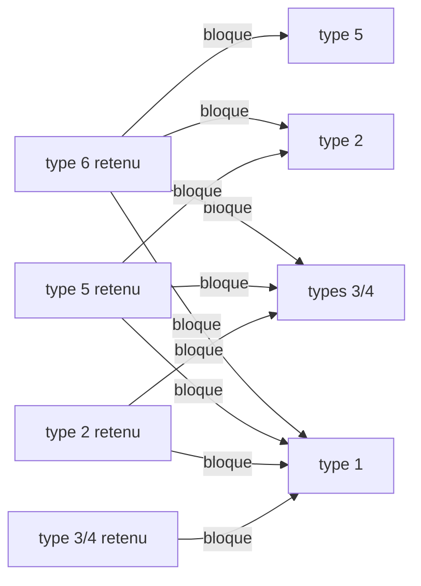

# Dialogues des PNJ : choix de la réplique

Implémentation : `crates/dq9-formats/src/dialogue.rs` (`parse`, `select`). Outil :
`cargo dq9re talk <archive> <membre> [--step N] [--context N] [--talks N] [--night]
[--quest Q=quartet] [--hero-down]…` décode le fichier et marque la réplique choisie pour cet
état.

## Chargement

`TalkTask_Update` (`ov_017::021b8e8c`), état 0 :

- archive `data/scenario/%s%c0.gp2` : `%s` = trois premiers caractères du nom de la carte
  (`M02`), `%c` = `Scenario_ChapterLetter` (`ov_017::0218d2c4`) appliqué au chapitre
  (`Save_Chapter`, sauvegarde `+0x5cb0`) : `"ABCDEFGHIJSTKLMNOPQ"[chapitre - 1]`, 1 à 19 ;
- membre `%03d_<LG>.bin` : `NNN` = premier `u16` de la définition du PNJ = identifiant du
  champ 0 de `<carte>npc.bin` (voir plus bas). Contrôle : 8 006 des 8 461 fichiers anglais
  ont un PNJ de ce numéro dans le `.npc` de leur carte ; les autres appartiennent aux cartes
  de terrain `F*` (qui partagent `F.npc`) ou sont des restes.

L'application utilisait déjà cette règle de nommage, mais initialisait les triggers avec
`1.1.1` même après chargement d'une sauvegarde : la démo en `C01M09`, progression `19.2.1`,
cherchait donc `C01A0` au lieu de `C01Q0`. Elle restaure désormais les cinq pistes et leurs
drapeaux, les drapeaux globaux et les quartets de quêtes du bloc sauvegardé ; `Field::enter`
sélectionne la piste de la salle avant la conversation. Les variantes d'une même famille de
cartes gardent les trois mêmes caractères ; ce n'est pas une recherche de chemins de secours.
La progression de la piste choisit la lettre, puis son étape et sa sous-étape choisissent la
réplique. Les options explicites de progression remplacent les champs correspondants.
Lors d'un changement de salle, la distribution des PNJ est construite à partir de la piste
**de destination** avant que `Field::enter` ne sélectionne cette même piste pour les triggers
et les conversations ; l'état courant n'est pas modifié pendant la préparation du cast.

Contrôles : sauvegarde de démonstration `19.2.1`, PNJ 25 en zone 80 : le navigateur ouvre
`C01Q0/025_en.bin`, enregistrement 0, et la ligne s'affiche ; chargement sauvegarde avant ou
après la ROM. Sur `M01`, étape 2, PNJ 2 : `M01A0/002_en.bin`, contexte 192, puis la fin de
conversation déclenche l'événement 1380. Le texte du prêtre se termine par `<ADD>` ; le service
religieux qui suit n'est pas implémenté.

Le fichier (une table d'enregistrements, `table.md`) passe par `Talk_SelectLine`
(`ov_017::021ba810`), qui rejette les PNJ hors de `0..=999`.

## Lecteur générique de tables (ARM9)

Le parseur des tables, cherché en vain jusqu'ici, est en `0x02030644`–`0x02030b8c` (noms
`Tbl_*` dans `re/symbols.txt`). Il reçoit un tableau `{u32 type; gestionnaire}` terminé par
le type 0 (`Tbl_SetHandlers` le trie par type), parcourt les enregistrements dans l'ordre du
fichier et appelle `gestionnaire(champs, nombre_de_champs)`, chaque champ décodé en
`{type, valeur}`. Les types sans gestionnaire sont ignorés. `Tbl_FieldInt` convertit un
flottant en entier et lit 0 pour une chaîne ; `Tbl_FieldStr` rend 0 si le champ n'est pas
une chaîne.

## Enregistrements

Gestionnaires : `g_TalkLineHandlers` (`ov_017::021d7c58`). Deux formes, selon le nombre de
champs :

```
4 champs : a, b, emplacement, texte
5 champs : a, b, nuit, emplacement, texte
```

| Type | Fonction | `a`, `b` | Garde supplémentaire | Fichiers (5 langues) |
|---|---|---|---|---|
| 1 | `TalkLine_Step` | étape min, max (`a < 0` : toujours) | aucune | 80 450 |
| 2 | `TalkLine_Quest` | quête, condition | invité d'une session : seulement quêtes > `0xad` | 90 430 |
| 3 | `TalkLine_SessionStepA` | étape min, max | session active, drapeau de pair local nul | 0 |
| 4 | `TalkLine_SessionStepB` | étape min, max | session active, drapeau de pair local non nul | 12 810 |
| 5 | `TalkLine_HostStep` | étape min, max | pas invité, mot du héros nul | 6 250 |
| 6 | `TalkLine_HostQuest` | quête, condition | comme 5 | 0 |

- **Étape** : `Save_ScenarioStep`, sauvegarde `+0x5cb4` ; il faut `a <= étape <= b`.
- **Quête** : 0 à `0xcb` ; la sauvegarde garde un quartet par quête à `+0x2cc` : bits 0-1
  = état (`Quest_State`), bits 2 et 3 = drapeaux. Condition `b` :

  | `b` | exige |
  |---|---|
  | -1 | état 0 |
  | 0 | état 2 |
  | 1 | bit 2 |
  | 2 | état 3 |
  | 3 | état 1 |
  | 4 | bit 3 et état 0 |
  | autre | rien (le `switch` n'a pas de cas par défaut ; jamais rencontré) |

  Sur la quête 11 de George (`M02M0/018`) : état 0 = pas encore disponible, 1 = disponible
  (le trigger de conversation vérifie alors le niveau avant de faire proposer la quête,
  `trigger.md`), 2 = acceptée, 3 = terminée. **[Noms tirés des textes et des triggers.]**
- **Nuit** (forme à 5 champs, valeur non nulle) : réplique ignorée de jour
  (`Save_IsDaytime`, sauvegarde `+0x3dc` non nulle). Une fois qu'une réplique de nuit a passé
  ce test, toutes les répliques **à 4 champs** suivantes sont ignorées ; les répliques à 5
  champs de valeur 0 restent possibles. Les textes de nuit (« Good evening », « Zzzz… »)
  confirment le sens.
- **Session** : `0x0202b7e8` (session sans fil active), `0x0202c550` (active et console
  locale ≠ pair 0, donc invitée), `0x0202c1b4` (octet du pair local à `+0x1038` de l'état de
  session) **[sens inconnu]**. **Mot du héros** : demi-mot à `héros->+0x130->+4`, les **PV
  du héros** **[hypothèse étayée, `trigger.md`]** : les types 5 et 6 exigent qu'ils soient
  nuls, c'est-à-dire qu'un autre membre parle à la place du héros tombé (« friend of
  `<HERO>` », silences des esprits que seul le héros entend). `dq9re talk` suppose le héros
  debout ; `--hero-down` le fait tomber.

### Emplacement (`Talk_SlotAccepts`, `ov_017::021b9bcc`)

`emplacement / 80` doit égaler `contexte / 80` (le contexte de conversation, ci-dessous) ;
puis, avec `t = emplacement % 80 / 16` et `n = emplacement % 16` :

| `t` | réplique retenue si |
|---|---|
| 0 | `n <=` compteur de conversations 1 du PNJ |
| 1 | `n <=` compteur 2 |
| 2, 3 | `emplacement == contexte` |
| 4 | `n <=` sauvegarde `+0x5cb8` (`Save_ScenarioSubstep`) et `n >=` meilleur `n` déjà retenu (le plus grand gagne) |

Les deux compteurs sont des quartets par PNJ dans deux tableaux de 128 octets
(`NpcTalkCount_Get`), tous deux incrémentés (saturés à 15) après chaque conversation
réussie. **[Différence entre les deux inconnue : l'un est peut-être remis à zéro au
chargement de la carte.]**

Emplacements observés : 0–3, 16–22 (groupe 0), 64–72 (test 4), 80–131 (groupe 1), 176–177,
192–223 (groupe 2, valeurs exactes).

### Choix

Toutes les répliques sont examinées dans l'ordre ; la **dernière** acceptée gagne, mais
certaines acceptations bloquent les types suivants :



Entre quêtes (types 2 et 6, chacun avec sa propre mémoire `g_TalkQuestLine`), une réplique
de la quête `q` ne remplace celle de la quête `Q` déjà retenue que si `q == Q`, si `q` est
dans l'état 1 ou 2, ou si `Q` et `q` sont dans l'état 3 avec `q >= Q`. La mémoire est un
octet signé : une quête > 127 retenue se relit comme « aucune » (bizarrerie conservée).

Sans réplique retenue, la conversation est abandonnée.

Test `dialogue_selection_follows_quest_state` : George (`M02M0/018_en`) dit « Those
betterflies are always hangin' about… » quand la quête 11 est acceptée, « I suppose those
monsters… » quand elle est terminée.

## Contexte de conversation

Champ `+0x124` de la tâche de conversation. `Talk_Start` (`ov_017::021a4cf0`) passe d'abord
l'événement « parler au PNJ » aux **triggers de la carte** (`trigger.md`) avec la zone
calculée par `Talk_NearestNpc` (`ov_017::021a4e88`) : identifiant de la **zone de
conversation** du PNJ qui contient le héros (rectangles x/z attachés au PNJ), 0 hors zone.
Les zones viennent des enregistrements de type 6 de `<carte>place.bin`
(`[pnj, x0, z0, x1, z1, id]`, `id` ∈ {0, 80, 192}).

- Si un trigger s'applique, ses actions s'exécutent ; l'action 0x76 lance la conversation
  avec le contexte qu'elle porte (0, 80–131, 160, 176, 192–223). C'est ainsi que sont
  atteintes les 20 023 répliques anglaises (sur 37 988) des emplacements exacts 192–223
  (offres et récompenses de quêtes…).
- Sinon, le contexte est la zone.

Deux autres appelants imposent `0xd7` et `0xc4`.

## `<carte>.npc` (NARC)

Deux tables d'enregistrements :

- `<carte>npc.bin`, type 3 : `[id, genre, nom japonais (Shift-JIS, souvent absent),
  modèle (n018a, s006…), ?]`.
- `<carte>place.bin` : placement par salle (`1200`… = salle). Type 3 :
  `[salle, pnj, x, y, z, angle]` ; type 5 : placement conditionnel ; type 6 : zone de
  conversation ; type 19 : `[pnj, modèle .chr, animation]`… **[à documenter]**.

## Partenaire : `Talk_NearestNpc` (`ov_017::021a4e88`)

Appelée avec 1 par la touche d'action (`Talk_FindPartner`, `ov_017::021a476c`, paramètre `1`)
et avec 0 sans elle. Décompilée et relue sur la ROM européenne (constantes des mots littéraux
`0x021a51a0` = `0x3244`, `0x021a4cdc` = `0x1922`) :

- **Candidats** : les objets de PNJ (32 emplacements). Un PNJ est candidat quand
  - **une de ses zones de conversation** (`place.bin` type 6, liste `+0x40` du nœud de
    placement, dans l'ordre du fichier) contient le héros, **strictement** sur x et z :
    `x < x_max ∧ z < z_max ∧ x > x_min ∧ z > z_min` (la hauteur n'est pas testée) ; ou
  - le héros est à moins de `0x1800` (1,5) sur x **et** sur z du PNJ. Si le placement porte un
    enregistrement de type 20 (`[f2, 0, f3, f1]`, `+0x5c` du nœud), le centre est décalé de
    `(f2, f3)` et la portée devient `f1 + 0x1000` (portée de distance `f1 + 0x1400`).
- **Choix** : l'angle entre la direction du héros et celle du PNJ
  (`ov_017::021a4700` : `FX_Atan2` de la différence normalisée, puis
  `fix32SignedAngleDistance`, en valeur absolue) doit être ≤ `0x3244` = **π** (`0x6488` =
  2π) : aucun PNJ n'est donc écarté pour son angle, seul le plus **face** au héros gagne.
  Un PNJ de zone est accepté dès que son angle n'est pas pire que le meilleur déjà retenu ;
  un PNJ libre doit en plus avoir un genre ≠ 1 (**les « choses à examiner » ne se parlent que
  depuis une zone**), être à moins de `0x1c00` (1,75, `VEC_Distance` en 3D) et faire
  strictement mieux que le meilleur PNJ libre.
- **Contexte** : l'identifiant de la zone du PNJ retenu, 0 pour un PNJ libre.
- Les drapeaux de l'objet (`0x200`…) et l'état « héros occupé » (`func_020535c8`…) écartent
  d'autres cas : **non modélisés**.

`dq9_core::talk::nearest` reprend ces règles, avec deux écarts : la distance de 1,75 est
mesurée au sol (les hauteurs des PNJ de l'application sont celles des placements, non
recalées), et `local_b4` (la portée de distance) n'est pas conservée d'un PNJ au
suivant (le jeu ne la réinitialise pas dans sa boucle : un PNJ à enregistrement 20 élargit
la portée des suivants, une bizarrerie non reproduite). Pas de marqueur `port:` : la fonction
n'est pas entièrement réimplémentée. Test `the_partner_is_in_range_and_the_most_faced` et
`zones_give_the_context_and_things_need_them` (données synthétiques).

### Lancement de la conversation (`Talk_Start`, `ov_017::021a4cf0`)

Le PNJ retenu est mis en `GameState+0x5724`, puis `Trig_Fire(événement 0)` reçoit
`[0] = PNJ`, `[5] = contexte`. Aucun trigger ne tient (`Trig_Fire` rend 0) : la tâche de
conversation démarre avec le contexte de la zone. Un trigger tient : seules ses actions
différées s'exécutent, et c'est l'action `0x76` qui lance la conversation (avec son propre
contexte). `dq9_core::field::Field::talk` rend `NoTrigger`, `Fired(événements)` ou
`Unsupported(condition)` ; l'application démarre la conversation sur `NoTrigger` et sur un
`Request::Talk` du PNJ, et transmet les autres événements (changement de carte, demandes
non supportées avant l'interpréteur `.stb`).

## Fenêtre de message

Sources : `MsgWin_Show` (`0x0204501c`), `MsgWin_Update` (`0x020659a0`, l'interpréteur des
codes `0xFFxx`), `MsgWin_WrapLines` (`0x0206b984`), `MsgWin_ParseSpeakerName`
(`0x0206ad84`), `Msg_ConsumeLeadingTags` (`0x0206a3d0`), `MsgWin_LoadFrames` (`0x0202f25c`) ;
wiki Text-Markup (adresses USA, vérifiées une à une sur la ROM EU : EU = USA + `0x10`).

### Géométrie (écran 256 × 192)

| Fait | Source |
|---|---|
| fenêtre `(x, y, l, h) = (2, 0x74, 0xfc, 0x4a)` = `(2, 116, 252, 74)` ; 3 lignes (`+0x9a4 = 3`, `<GYOU=n>`) de 20 pixels (`+0x1864 = 0x14`), cellule de police 12 × 16 (`<MOJI=w,h>`) | `MsgWin_Show` (`MsgWin_SetRect(win, 2, 0x74, 0xfc, 0x4a)`) |
| variante sans cadre : rectangle `(2, 0x92, 0xfc, 0x4a)`, `+0x19b1 = 0` | `MsgWin_SetFramelessRect` |
| cadre = **8 morceaux 8 × 8** `data/ani/win0..7.spr` : coin haut-gauche, bord haut, coin haut-droit, bord droit, coin bas-droit, bord bas, coin bas-gauche, bord gauche ; palette de 4 couleurs par morceau, indice 0 transparent | `MsgWin_LoadFrames` (`sprintf("ARC:win%d.spr")`), contenu des fichiers |
| chaque morceau a une marge transparente d'un pixel : ils se posent **tous les 6 pixels** (bords) sous les coins | motifs des 8 fichiers |
| plaque de nom (`//Nom//`) : largeur `a + 26 − (a & 7)` avec `a` = avance du nom (somme des `largeur + 1`), hauteur 22 | `MsgWin_ParseSpeakerName` (`+0x934`, `+0x936`) |
| `<CEN>` : octet `+0x19b8` ; `<WIN>` : `+0x19b1 = 0` (cadre non dessiné) ; `<RECT=x,y,l,h>` : rectangle (x ≤ 256, y ≤ 192, l et h négatifs → reste de l'écran) ; `<COLOR=r,g,b>` : couleur du texte en BGR555 (composantes bornées à 255, négative → 255) ; `<SKIP>` : `+0x19bb = 0` | `Msg_ConsumeLeadingTags` |

**[Hypothèses, non lues]** : marges du texte dans la fenêtre (12 et 10 pixels), largeur de
césure (228), position de la plaque (6 pixels du bord gauche, 4 pixels de recouvrement),
position et taille de la fenêtre Oui/Non, couleur de fond (bleu nuit translucide), choix de
`arrow2.spr` pour la flèche d'attente, sens exact de `<CEN>` (boîte centrée verticalement,
lignes centrées : `MessageCountLines` multiplie `lignes − 1` par la hauteur de ligne pour
centrer la fenêtre). La capture d'une fenêtre dans melonDS n'a pas été faite : ces choix se
corrigent d'après une capture, ils sont des constantes de `dq9-app/src/talk.rs`.

`*:` n'est **pas** retiré du flux : il est dessiné (glyphes `*` de 7 pixels puis `:` de 1
pixel de la police). `MsgWin_ParseSpeakerName` cherche `//`, `*:` et `*<:>` : avec `//`, le nom
et l'espace qui suit sont sautés ; avec `*:` seul l'octet `+0x912` vaut 3 (animation de la
flèche **[inconnu]**). Le nom est lu à chaque page : il apparaît après `<PAGE>`
(`//Cap<1>n Max Meddlin//` …).

### Mise en page (`MsgWin_WrapLines`)

Avance d'un glyphe = crénage + largeur + 1 ; un espace = largeur des espaces + 1. Quand le
glyphe suivant dépasserait la largeur (`largeur_max < x + crénage + largeur`) et qu'une
coupure a été vue, la ligne est coupée à la **dernière coupure** — après une espace (qui
disparaît) ou après un glyphe `-` — et la fin passe à la ligne suivante. Sans coupure
possible, le mot déborde. `\n`, `<PAGE>` et `//…// ` remettent la position à zéro.
La quatrième ligne d'une page **fait défiler** la fenêtre (`+0x19b4`, `+0x1868`) : un pixel
par tick jusqu'à la hauteur de ligne (20) puis `func_0206b61c` (EU `0x0206b62c`), sans
attendre de touche **[hypothèse : un pixel par tick]**. `dq9-core` attend 20 pas, puis
fait remonter les lignes d'un coup (pas de défilement lissé).

### Codes et états d'attente (`+0x9a0`)

| Code | Effet lu dans `MsgWin_Update` |
|---|---|
| `0xFF01` `<END>`, `0xFF02` | état 0 : le texte reste, le jeu attend la touche puis ferme |
| `0xFF03` `<CLOSE>` | état 0 puis fermeture immédiate (`func_02043204`, `func_02043124`) |
| `0xFF0A` `<ADD>` | état 3 : la fenêtre reste pour le message suivant de la scène |
| `0xFF0B` `<AUTO=n>` | état 4 : compte à rebours puis page suivante |
| `0xFF0C`, `0xFF0D` | état 1 : attente de la touche (flèche), puis la page est effacée |
| `0xFF1A` `<TIME=n>` | compte `+0x186c + 4 × slot` décrémenté à chaque tick |
| `0xFF1D`, `0xFF1E`, `0xFF1F` | état 2 : attente de la touche (avec ou sans curseur) |
| `0xFF04`–`0xFF07`, `0xFF08` | état 6 : choix ; `0xFF05` (`<NOYES>`) place le curseur sur Non ; réponse dans `+0x954` (haut/bas déplacent, A valide, B annule = −2) |
| `0xFF14`–`0xFF17` | **aucune arme** dans l'interpréteur : simples repères |
| `0xFF26`/`0xFF27`, `0xFF28`/`0xFF29` | `+0x19b1` (cadre) et `+0x19b8` (centrage) |
| `0xFF2A`…`0xFF2F`, `0xFF0E`, `0xFF10`–`0xFF13`, `0xFF34`–`0xFF48`, `0xFF4B`… | tours du PNJ, ballons, secousse, quêtes, sons : **non modélisés** |

**Les repères `<YES>`/`<NO>` sont des cibles de saut [hypothèse étayée]** : l'interpréteur
les ignore en lecture linéaire, et les textes en alternent les branches (`<YESNO><YES>A<END>
<NO>B<END>`, `<YESNO><NO>B<END><YES>A`). Après la réponse, `dq9-core` reprend la lecture
**après le premier repère de la réponse qui suit la question**, la boîte effacée ; sans repère,
elle reprend au prochain `<END>`. `<JP_x>` saute après `<LB_x>` (le moteur recherche le
code `0xFFD0 + n` dans tout le flux) : des questions reviennent par ce moyen (« Voulez-vous
une explication ? »). Test réel `every_npc_line_plays_to_its_end` : les 37 988 répliques
anglaises (toutes les lignes de `<carte><lettre>0.gp2`) se compilent, se mettent en page et
se jouent jusqu'à la fermeture, en répondant Oui et Non tour à tour (775 n'affichent aucun
glyphe : `<END>` seul, `<ADD>`…).

### Vitesse du texte **[hypothèse]**

`MsgWin_Update` avance de `ticks` caractères par appel (`+0x80 += ticks × 0x10`, retenue
`>> 4`) ; `ticks` = `GetTickCount` (2 par mise à jour de 33 ms, `stb-natives.md`) : un
glyphe par tick de 1/60 s. La touche d'action pendant la frappe affiche le texte jusqu'à
la prochaine attente (hypothèse d'après `+0x19c5`, qui force 16 caractères par appel).

## Implémentation

- `dq9_formats::message::leading_tags` : balises de tête (`Msg_ConsumeLeadingTags`).
- `dq9_core::talk` : `nearest`, `TalkCounts` (compteurs `NpcTalkCount`, remis à zéro de
  la carte à l'entrée d'une carte), `compile_message`/`layout`/`prepare` (les six passes avec
  le nom du héros « Hero » et les conditions sexe/solo, puis mise en page), `Dialogue::step`
  (une touche par pas fixe de 60 Hz) et `Dialogue::view`.
- `dq9_render::ui` : atlas (police en alpha, morceaux de cadre, flèche), quads en pixels DS,
  pipeline wgpu dessinant sur l'image 3D finie, dans le plus grand 4:3 de la cible.
- `dq9-app/src/talk.rs` : choix de la réplique (`<carte><lettre>0.gp2`, `NNN_en.bin`,
  `dialogue::select` avec l'état des triggers : étape, sous-étape, quêtes, jour/nuit), fenêtre,
  plaque de nom, fenêtre Oui/Non ; entrées `Entrée`/`Espace`/`Z` (A), `Retour`/`X` (B),
  haut/bas ; `--input` pour les captures.

## Reste

- PNJ immobiles et tournés vers le héros pendant la conversation (`<N_TURN>` et
  `TextConsumeLeadingTags` les gèrent : la rotation est `func_02033834`, l'objet modèle n'a pas
  d'API d'orientation dans `AnimatedScene`) ; ballons `<EXC>`/`<QES>`.
- Services (`<INN=n>`, `<SHOP=n>`…), quêtes (`<QUEST=n>`), sons, secousse, `<AUTO>`,
  `<PAGE_T>` (attend la touche ici), `<ALL_RECOVER>`.
- Les constantes de mise en page ci-dessus à confirmer sur une capture melonDS ; la langue
  est l'anglais (`NNN_en.bin`), le nom du héros « Hero » (le nom de la sauvegarde n'est pas
  lu) ; les conditions `<IF_…>` autres que sexe/solo prennent leur première branche.
- `<TC#>`, `<PLTT=#>`, `<W=#>`, `<CURSOR=#>`, `<TRI-L/R>`, `<LG>` : comptées dans les textes
  anglais (`dq9re text --lang en`), `<TC…>` et `<TRI…>` n'y apparaissent jamais, `<PLTT=>`
  4 fois, `<CURSOR=>` et `<LG>` 1 fois, `<W=>` 5 fois, toutes dans des chaînes de menus
  (`profstr`, `str_bres`, `str_da12`…) : hors du chemin des répliques de PNJ et des textes
  d'événements du prologue, non prises en charge ; la balise de tête réellement utilisée
  par le prologue est `<CEN>`.
