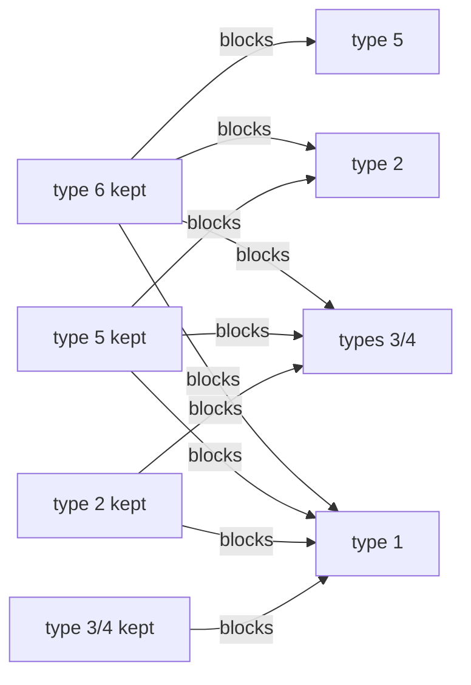

# NPC dialogue: choosing the line

Implementation: `crates/dq9-formats/src/dialogue.rs` (`parse`, `select`). Tool:
`cargo dq9re talk <archive> <member> [--step N] [--context N] [--talks N] [--night]
[--quest Q=quartet] [--hero-down]…` decodes the file and marks the line chosen for that
state.

## Loading

`TalkTask_Update` (`ov_017::021b8e8c`), state 0:

- archive `data/scenario/%s%c0.gp2`: `%s` = first three characters of the map name
  (`M02`), `%c` = `Scenario_ChapterLetter` (`ov_017::0218d2c4`) applied to the chapter
  (`Save_Chapter`, save `+0x5cb0`): `"ABCDEFGHIJSTKLMNOPQ"[chapter - 1]`, 1 to 19;
- member `%03d_<LG>.bin`: `NNN` = first `u16` of the NPC definition = identifier of
  field 0 of `<map>npc.bin` (see below). Check: 8,006 of the 8,461 English files
  have an NPC with that number in their map's `.npc`; the others belong to the field
  maps `F*` (which share `F.npc`) or are leftovers.

The application already used this naming rule, but initialized the triggers with
`1.1.1` even after loading a save: the demo in `C01M09`, progress `19.2.1`,
therefore looked for `C01A0` instead of `C01Q0`. It now restores the five tracks and their
flags, the global flags and the quest quartets from the save block; `Field::enter`
selects the room's track before the conversation. Variants of the same map family
keep the same three characters; this is not a fallback path search.
The track's progress chooses the letter, then its step and substep choose the
line. Explicit progress options replace the matching fields.
On a room change, the NPC cast is built from the **destination** track before
`Field::enter` selects that same track for triggers and conversations; the current
state is not modified while the cast is prepared.

Checks: demo save `19.2.1`, NPC 25 in zone 80: the browser opens
`C01Q0/025_en.bin`, record 0, and the line is displayed; save loaded before or
after the ROM. On `M01`, step 2, NPC 2: `M01A0/002_en.bin`, context 192, then the end of
the conversation fires event 1380. The priest's text ends with `<ADD>`; the religious
service that follows is not implemented.

The file (a record table, `table.md`) goes through `Talk_SelectLine`
(`ov_017::021ba810`), which rejects NPCs outside `0..=999`.

## Generic table reader (ARM9)

The table parser, searched for in vain until now, is at `0x02030644`–`0x02030b8c` (names
`Tbl_*` in `re/symbols.txt`). It receives an array `{u32 type; handler}` terminated by
type 0 (`Tbl_SetHandlers` sorts it by type), walks the records in file
order and calls `handler(fields, field_count)`, each field decoded as
`{type, value}`. Types without a handler are skipped. `Tbl_FieldInt` converts a
float to an integer and reads 0 for a string; `Tbl_FieldStr` returns 0 if the field is not
a string.

## Records

Handlers: `g_TalkLineHandlers` (`ov_017::021d7c58`). Two forms, depending on the number of
fields:

```
4 fields: a, b, slot, text
5 fields: a, b, night, slot, text
```

| Type | Function | `a`, `b` | Extra guard | Files (5 languages) |
|---|---|---|---|---|
| 1 | `TalkLine_Step` | min, max step (`a < 0`: always) | none | 80,450 |
| 2 | `TalkLine_Quest` | quest, condition | guest of a session: only quests > `0xad` | 90,430 |
| 3 | `TalkLine_SessionStepA` | min, max step | session active, local peer flag zero | 0 |
| 4 | `TalkLine_SessionStepB` | min, max step | session active, local peer flag non-zero | 12,810 |
| 5 | `TalkLine_HostStep` | min, max step | not a guest, hero word zero | 6,250 |
| 6 | `TalkLine_HostQuest` | quest, condition | like 5 | 0 |

- **Step**: `Save_ScenarioStep`, save `+0x5cb4`; requires `a <= step <= b`.
- **Quest**: 0 to `0xcb`; the save keeps one quartet per quest at `+0x2cc`: bits 0-1
  = state (`Quest_State`), bits 2 and 3 = flags. Condition `b`:

  | `b` | requires |
  |---|---|
  | -1 | state 0 |
  | 0 | state 2 |
  | 1 | bit 2 |
  | 2 | state 3 |
  | 3 | state 1 |
  | 4 | bit 3 and state 0 |
  | other | nothing (the `switch` has no default case; never encountered) |

  On George's quest 11 (`M02M0/018`): state 0 = not yet available, 1 = available
  (the conversation trigger then checks the level before offering the quest,
  `trigger.md`), 2 = accepted, 3 = completed. **[Names derived from texts and triggers.]**
- **Night** (5-field form, non-zero value): line skipped during the day
  (`Save_IsDaytime`, save `+0x3dc` non-zero). Once a night line has passed
  this test, all following **4-field** lines are skipped; 5-field lines
  with value 0 remain possible. The night texts ("Good evening", "Zzzz…")
  confirm the meaning.
- **Session**: `0x0202b7e8` (wireless session active), `0x0202c550` (active and local
  console ≠ peer 0, hence guest), `0x0202c1b4` (local peer byte at `+0x1038` of the session
  state) **[meaning unknown]**. **Hero word**: halfword at `hero->+0x130->+4`, the **hero's
  HP** **[supported hypothesis, `trigger.md`]**: types 5 and 6 require it to be
  zero, i.e. another member speaks in place of the fallen hero ("friend of
  `<HERO>`", silences of spirits that only the hero hears). `dq9re talk` assumes the hero
  is standing; `--hero-down` knocks them down.

### Slot (`Talk_SlotAccepts`, `ov_017::021b9bcc`)

`slot / 80` must equal `context / 80` (the conversation context, below);
then, with `t = slot % 80 / 16` and `n = slot % 16`:

| `t` | line kept if |
|---|---|
| 0 | `n <=` the NPC's conversation counter 1 |
| 1 | `n <=` counter 2 |
| 2, 3 | `slot == context` |
| 4 | `n <=` save `+0x5cb8` (`Save_ScenarioSubstep`) and `n >=` best `n` already kept (the largest wins) |

The two counters are per-NPC quartets in two 128-byte arrays
(`NpcTalkCount_Get`), both incremented (saturating at 15) after each successful
conversation. **[Difference between the two unknown: one may be reset on
map load.]**

The two arrays are at pointer `gameres+0x44c4` (the game resources), and two resets
are established:

- **New chapter or new step**: `Track_Advance` (`0x020703d8`, actions 0x84,
  0x94, 0xd6) calls `0x0206ec04` (zeroing of the 2 × 0x80 bytes) in both branches
  where the track changes chapter (`Track_ClearFlags`) or, within the same chapter, step
  (`Track_ClearStepFlags`), and only when progress moves forward. A new
  substep alone resets nothing. The counters are shared by the five tracks:
  advancing any of them clears them all.
- **Action 0x6a** (`Trig_RunAction` case 6, `0x02061c14`): `0x0206ecf8(table, NPC)` on
  each of the two arrays clears the quartet of NPC `arg` (byte `NPC / 2`, high quartet
  for an even number); a number ≥ 256 falls outside the array and errors (`0x0209954c`).

Observed slots: 0–3, 16–22 (group 0), 64–72 (test 4), 80–131 (group 1), 176–177,
192–223 (group 2, exact values).

### Choice

All lines are examined in order; the **last** accepted one wins, but
some acceptances block the following types:



Between quests (types 2 and 6, each with its own memory `g_TalkQuestLine`), a line
of quest `q` only replaces the one of quest `Q` already kept if `q == Q`, if `q` is
in state 1 or 2, or if `Q` and `q` are in state 3 with `q >= Q`. The memory is a
signed byte: a kept quest > 127 reads back as "none" (quirk preserved).

With no line kept, the conversation is abandoned.

Test `dialogue_selection_follows_quest_state`: George (`M02M0/018_en`) says "Those
betterflies are always hangin' about…" when quest 11 is accepted, "I suppose those
monsters…" when it is completed.

## Conversation context

Field `+0x124` of the conversation task. `Talk_Start` (`ov_017::021a4cf0`) first passes
the "talk to NPC" event to the **map triggers** (`trigger.md`) with the zone
computed by `Talk_NearestNpc` (`ov_017::021a4e88`): identifier of the NPC's **conversation
zone** that contains the hero (x/z rectangles attached to the NPC), 0 outside a zone.
The zones come from the type 6 records of `<map>place.bin`
(`[npc, x0, z0, x1, z1, id]`, `id` ∈ {0, 80, 192}).

- If a trigger applies, its actions run; action 0x76 starts the conversation
  with the context it carries (0, 80–131, 160, 176, 192–223). This is how the
  20,023 English lines (out of 37,988) of the exact slots 192–223 are reached
  (quest offers and rewards…).
- Otherwise, the context is the zone.

Two other callers impose `0xd7` and `0xc4`.

## `<map>.npc` (NARC)

Two record tables:

- `<map>npc.bin`, type 3: `[id, gender, Japanese name (Shift-JIS, often missing),
  model (n018a, s006…), ?]`.
- `<map>place.bin`: placement per room (`1200`… = room). Type 3:
  `[room, npc, x, y, z, angle]`; type 5: conditional placement; type 6: conversation
  zone; type 19: `[npc, .chr model, animation]`… **[to be documented]**.

## Partner: `Talk_NearestNpc` (`ov_017::021a4e88`)

Called with 1 by the action button (`Talk_FindPartner`, `ov_017::021a476c`, parameter `1`)
and with 0 without it. Decompiled and re-read on the European ROM (literal word constants
`0x021a51a0` = `0x3244`, `0x021a4cdc` = `0x1922`):

- **Candidates**: the NPC objects (32 slots). An NPC is a candidate when
  - **one of its conversation zones** (`place.bin` type 6, list `+0x40` of the placement
    node, in file order) contains the hero, **strictly** on x and z:
    `x < x_max ∧ z < z_max ∧ x > x_min ∧ z > z_min` (height is not tested); or
  - the hero is less than `0x1800` (1.5) from the NPC on x **and** on z. If the placement carries a
    type 20 record (`[f2, 0, f3, f1]`, `+0x5c` of the node), the center is offset by
    `(f2, f3)` and the range becomes `f1 + 0x1000` (distance range `f1 + 0x1400`).
- **Choice**: the angle between the hero's direction and the NPC's
  (`ov_017::021a4700`: `FX_Atan2` of the normalized difference, then
  `fix32SignedAngleDistance`, in absolute value) must be ≤ `0x3244` = **π** (`0x6488` =
  2π): no NPC is therefore excluded for its angle, only the one most **facing** the hero wins.
  A zone NPC is accepted as soon as its angle is no worse than the best already kept;
  a free NPC must in addition have a gender ≠ 1 (**"things to examine" can only be talked to
  from a zone**), be less than `0x1c00` away (1.75, `VEC_Distance` in 3D) and be
  strictly better than the best free NPC.
- **Context**: the identifier of the kept NPC's zone, 0 for a free NPC.
- The object flags (`0x200`…) and the "hero busy" state (`func_020535c8`…) exclude
  other cases: **not modeled**.

`dq9_core::talk::nearest` reproduces these rules, with two deviations: the 1.75 distance is
measured on the ground (the application's NPC heights are those of the placements, not
re-snapped), and `local_b4` (the distance range) is not kept from one NPC to the
next (the game does not reset it in its loop: an NPC with record 20 widens
the range of the following ones, a quirk not reproduced). No `port:` marker: the function
is not fully reimplemented. Tests `the_partner_is_in_range_and_the_most_faced` and
`zones_give_the_context_and_things_need_them` (synthetic data).

### Starting the conversation (`Talk_Start`, `ov_017::021a4cf0`)

The kept NPC is stored in `GameState+0x5724`, then `Trig_Fire(event 0)` receives
`[0] = NPC`, `[5] = context`. No trigger holds (`Trig_Fire` returns 0): the conversation
task starts with the zone's context. A trigger holds: only its deferred actions
run, and it is action `0x76` that starts the conversation (with its own
context). `dq9_core::field::Field::talk` returns `NoTrigger`, `Fired(events)` or
`Unsupported(condition)`; the application starts the conversation on `NoTrigger` and on a
`Request::Talk` of the NPC, and forwards the other events (map change, requests
unsupported before the `.stb` interpreter).

## Message window

Sources: `MsgWin_Show` (`0x0204501c`), `MsgWin_Update` (`0x020659a0`, the interpreter of
`0xFFxx` codes), `MsgWin_WrapLines` (`0x0206b984`), `MsgWin_ParseSpeakerName`
(`0x0206ad84`), `Msg_ConsumeLeadingTags` (`0x0206a3d0`), `MsgWin_LoadFrames` (`0x0202f25c`);
Text-Markup wiki (USA addresses, checked one by one on the EU ROM: EU = USA + `0x10`).

### Geometry (256 × 192 screen)

| Fact | Source |
|---|---|
| window `(x, y, w, h) = (2, 0x74, 0xfc, 0x4a)` = `(2, 116, 252, 74)`; 3 lines (`+0x9a4 = 3`, `<GYOU=n>`) of 20 pixels (`+0x1864 = 0x14`), font cell 12 × 16 (`<MOJI=w,h>`) | `MsgWin_Show` (`MsgWin_SetRect(win, 2, 0x74, 0xfc, 0x4a)`) |
| frameless variant: rectangle `(2, 0x92, 0xfc, 0x4a)`, `+0x19b1 = 0` | `MsgWin_SetFramelessRect` |
| frame = **8 pieces 8 × 8** `data/ani/win0..7.spr`: top-left corner, top edge, top-right corner, right edge, bottom-right corner, bottom edge, bottom-left corner, left edge; 4-color palette per piece, index 0 transparent | `MsgWin_LoadFrames` (`sprintf("ARC:win%d.spr")`), file contents |
| each piece has a one-pixel transparent margin: they are laid **every 6 pixels** (edges) under the corners | patterns of the 8 files |
| name plate (`//Name//`): width `a + 26 − (a & 7)` with `a` = name advance (sum of `width + 1`), height 22 | `MsgWin_ParseSpeakerName` (`+0x934`, `+0x936`) |
| `<CEN>`: byte `+0x19b8`; `<WIN>`: `+0x19b1 = 0` (frame not drawn); `<RECT=x,y,w,h>`: rectangle (x ≤ 256, y ≤ 192, negative w and h → rest of the screen); `<COLOR=r,g,b>`: text color in BGR555 (components clamped to 255, negative → 255); `<SKIP>`: `+0x19bb = 0` | `Msg_ConsumeLeadingTags` |

**[Hypotheses, not read]**: text margins inside the window (12 and 10 pixels), wrap
width (228), plate position (6 pixels from the left edge, 4 pixels of overlap),
position and size of the Yes/No window, background color (translucent midnight blue), choice of
`arrow2.spr` for the wait arrow, exact meaning of `<CEN>` (box vertically centered,
lines centered: `MessageCountLines` multiplies `lines − 1` by the line height to
center the window). A capture of a window in melonDS has not been done: these choices are
to be corrected from a capture, they are constants of `dq9-app/src/talk.rs`.

`*:` is **not** removed from the stream: it is drawn (glyphs `*` of 7 pixels then `:` of 1
pixel from the font). `MsgWin_ParseSpeakerName` looks for `//`, `*:` and `*<:>`: with `//`, the name
and the following space are skipped; with `*:` only byte `+0x912` is set to 3 (arrow
animation **[unknown]**). The name is read on each page: it appears after `<PAGE>`
(`//Cap<1>n Max Meddlin//` …).

### Layout (`MsgWin_WrapLines`)

Glyph advance = kerning + width + 1; a space = space width + 1. When the
next glyph would exceed the width (`max_width < x + kerning + width`) and a
break has been seen, the line is broken at the **last break** — after a space (which
disappears) or after a `-` glyph — and the rest moves to the next line. With no possible
break, the word overflows. `\n`, `<PAGE>` and `//…// ` reset the position to zero.
The fourth line of a page **scrolls** the window (`+0x19b4`, `+0x1868`): one pixel
per tick up to the line height (20) then `func_0206b61c` (EU `0x0206b62c`), without
waiting for a button **[hypothesis: one pixel per tick]**. `dq9-core` waits 20 steps, then
moves the lines up at once (no smooth scrolling).

### Codes and wait states (`+0x9a0`)

| Code | Effect read in `MsgWin_Update` |
|---|---|
| `0xFF01` `<END>`, `0xFF02` | state 0: the text stays, the game waits for the button then closes |
| `0xFF03` `<CLOSE>` | state 0 then immediate close (`func_02043204`, `func_02043124`) |
| `0xFF0A` `<ADD>` | state 3: the window stays for the scene's next message |
| `0xFF0B` `<AUTO=n>` | state 4: countdown then next page |
| `0xFF0C`, `0xFF0D` | state 1: wait for the button (arrow), then the page is cleared |
| `0xFF1A` `<TIME=n>` | counter `+0x186c + 4 × slot` decremented on each tick |
| `0xFF1D`, `0xFF1E`, `0xFF1F` | state 2: wait for the button (with or without cursor) |
| `0xFF04`–`0xFF07`, `0xFF08` | state 6: choice; `0xFF05` (`<NOYES>`) places the cursor on No; answer in `+0x954` (up/down move, A confirms, B cancels = −2) |
| `0xFF14`–`0xFF17` | **no handler** in the interpreter: plain markers |
| `0xFF26`/`0xFF27`, `0xFF28`/`0xFF29` | `+0x19b1` (frame) and `+0x19b8` (centering) |
| `0xFF2A`…`0xFF2F`, `0xFF0E`, `0xFF10`–`0xFF13`, `0xFF34`–`0xFF48`, `0xFF4B`… | NPC turns, balloons, shake, quests, sounds: **not modeled** |

Choice sounds (details and evidence in [`sdat.md`](sdat.md)): opening, effect 5; answer,
effect 1, except `<YESNO_NOTSE>` (`0xFF06`, no answer) and `<YESNO_NOTSE_IIE>` (`0xFF07`,
second answer); B is silent. Moving up/down plays no effect.

**The `<YES>`/`<NO>` markers are jump targets [supported hypothesis]**: the interpreter
ignores them in linear reading, and the texts alternate their branches (`<YESNO><YES>A<END>
<NO>B<END>`, `<YESNO><NO>B<END><YES>A`). After the answer, `dq9-core` resumes reading
**after the first marker of the answer that follows the question**, the box cleared; with no marker,
it resumes at the next `<END>`. `<JP_x>` jumps after `<LB_x>` (the engine searches for the
code `0xFFD0 + n` in the whole stream): some questions repeat this way ("Do you want
an explanation?"). Real test `every_npc_line_plays_to_its_end`: the 37,988 English
lines (all the lines of `<map><letter>0.gp2`) compile, lay out and
play until closing, answering Yes and No in turn (775 display no
glyph: `<END>` alone, `<ADD>`…).

### Text speed **[hypothesis]**

`MsgWin_Update` advances `ticks` characters per call (`+0x80 += ticks × 0x10`, carry
`>> 4`); `ticks` = `GetTickCount` (2 per 33 ms update, `stb-natives.md`): one
glyph per 1/60 s tick. The action button during typing shows the text up to
the next wait (hypothesis based on `+0x19c5`, which forces 16 characters per call).

## Implementation

- `dq9_formats::message::leading_tags`: leading tags (`Msg_ConsumeLeadingTags`).
- `dq9_core::talk`: `nearest`, `TalkCounts` (`NpcTalkCount` counters, the map's reset
  on entering a map, all of them by `Track_Advance` on a new chapter or a
  new step, an NPC's by action 0x6a; carried by `trigger::State::talk_counts`),
  `compile_message`/`layout`/`prepare` (the six passes with
  the hero's identity — name and gender taken from the save, otherwise male "Hero" —
  and the gender/solo conditions, then layout), `Dialogue::step` (one button per fixed
  60 Hz step) and `Dialogue::view`.
- Hero identity: `dq9-app` reads it from the save's current slot
  (`Save::current_slot`) and from the first party character (index `standby_count`),
  like the hero model: name `+0x140` as glyph indices of the message font,
  gender `+0x174` bit 0 (0 male, 1 female, `characters.md`). `Talk::set_identity` rebuilds
  the `Names` from the glyph text, so `<HERO>`, `<LEADER>` and `<ADDRESSEE>`
  carry the player's name and `<IF_HERO_MALE>`/`<IF_MALE>` follow their gender. Without a save,
  for a new game or after a replaced save (Web reload), the default identity
  male "Hero" comes back. Checked on the bytes of the demo save
  (`save.md`): record `standby_count` 0, the indices of `+0x140` decode to "Adenine"
  in `fi_me.bin` and `+0x174` bit 0 is 1.
- `dq9_render::ui`: atlas (font in alpha, frame pieces, arrow), quads in DS pixels,
  wgpu pipeline drawing over the finished 3D image, in the largest 4:3 of the target.
- `dq9-app/src/talk.rs`: line choice (`<map><letter>0.gp2`, `NNN_en.bin`,
  `dialogue::select` with the trigger state: step, substep, quests, day/night), window,
  name plate, Yes/No window; inputs `Enter`/`Space`/`Z` (A), `Backspace`/`X` (B),
  up/down; `--input` for captures.

## Remaining

- NPCs still and turned towards the hero during the conversation (`<N_TURN>` and
  `TextConsumeLeadingTags` handle them: the rotation is `func_02033834`, the model object has no
  orientation API in `AnimatedScene`); balloons `<EXC>`/`<QES>`.
- Services (`<INN=n>`, `<SHOP=n>`…), quests (`<QUEST=n>`), sounds, shake, `<AUTO>`,
  `<PAGE_T>` (waits for the button here), `<ALL_RECOVER>`.
- The layout constants above to be confirmed on a melonDS capture; the language
  is English (`NNN_en.bin`), the hero's name comes from the save's current slot
  (default "Hero" without a save); `<IF_…>` conditions other than gender/solo take
  their first branch.
- `<TC#>`, `<PLTT=#>`, `<W=#>`, `<CURSOR=#>`, `<TRI-L/R>`, `<LG>`: counted in the English
  texts (`dq9re text --lang en`), `<TC…>` and `<TRI…>` never appear there, `<PLTT=>`
  4 times, `<CURSOR=>` and `<LG>` once, `<W=>` 5 times, all in menu strings
  (`profstr`, `str_bres`, `str_da12`…): off the path of NPC lines and of the
  prologue's event texts, not supported; the leading tag actually used
  by the prologue is `<CEN>`.
