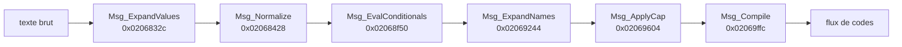

# Textes et balisage des messages

Les textes du jeu sont des chaînes ASCII avec balises `<…>`, stockées dans les tables
d'enregistrements (`table.md`) et dans les fichiers `.nat`. Une langue par fichier
(`_de`, `_en`, `_es`, `_fr`, `_it`). Le jeu interprète les balises à l'exécution.

`cargo dq9re text --lang en` écrit toutes les chaînes des tables dans `build/text/en/`
(51 089 chaînes en anglais, 1 441 fichiers).

## Réimplémentation

`crates/dq9-formats/src/message.rs` reproduit les six passes (une fonction par passe, l'état
du jeu fourni par des fermetures). `cargo dq9re msg <archive.gp2> <membre> [n]` fait passer un
dialogue par tout le pipeline avec un contexte d'aperçu (héros « Hero », première branche de
chaque condition) et dessine les pages avec la police du jeu (`build/msg.png`).

Test `message_pipeline_leaves_only_glyphs` : les 272 484 chaînes des tables (5 langues)
traversent le pipeline ; ensuite, tout octet de texte est un glyphe ou un espace, sauf ces
balises laissées à d'autres systèmes **[non localisés]** :

| Balise | Hypothèse |
|---|---|
| `<RIKKA>`, `<LUIDA>`, `<DAMA>`, `<RENKIN>` | noms de personnages / lieux (Rikka, Luida…) remplacés ailleurs ; `RIKKA` apparaît dans l'ARM9 à `0x020f0ab1` |
| `<CEN>` | centrage de ligne |
| `<TC#>`, `<PLTT=#>` | couleur du texte / palette |
| `<W=#>`, `<CURSOR=#>`, `<TRI-L>`, `<TRI-R>`, `<LG>` | mise en page des menus |

S'y ajoutent deux fautes de frappe dans les données (`<ADDRESSE>`, et un bloc fermé par
`<END_IF_MALE>` au lieu de `<ENDIF_MALE>`), et des `<END>`/`<END_R_TURN>` qui suivent une
balise supprimée par `Msg_Compile` (`<INN=…>`…) : le jeu recopie alors le `<` suivant comme du
texte. **[À vérifier en émulateur : ces messages passent peut-être par un autre chemin.]**

## Caractères

- Pas d'octets non ASCII dans les textes européens : accents et signes spéciaux sont des
  **noms de glyphes** de la police (`font.md`) — `<'e>` (é), `<^e>` (ê), `` <`a> `` (à),
  `<ss>` (ß), `<1>` (apostrophe typographique), `<,>`, `<heart>`… Le moteur prend le **premier**
  glyphe, dans l'ordre de la table, dont la chaîne commence à la position courante.
- Retour à la ligne : les deux caractères `\n` (barre oblique inverse + `n`), ou `\r\n`/`\n`
  réels ; tous deviennent le code `0xFF18`.
- `//Nom//` en début de réplique : nom de l'orateur **[hypothèse : affiché dans un cadre]** ;
  `*:` = orateur anonyme.

## Pipeline (ARM9)

`Msg_Prepare` (`0x02067ea8`) enchaîne six passes, chacune copiant d'un tampon à l'autre (noms
dans `re/symbols.txt`) :



Délimitation d'une balise : de `<` jusqu'au premier `>` **non suivi** d'un autre `>`
(`Msg_FindTagEnd`, `0x020424bc`), pour que le glyphe `<>>>` (») reste lisible.

### 0. `Msg_ExpandValues` : valeurs numériques

Table `0x020e7e6c` : `<val_n>` / `<VAL_n>` → `MsgSubst_VAL` (`0x02068248`), qui insère la
n-ième valeur passée au message.

### 1. `Msg_Normalize` : filtrage par la police

Pour chaque position : une chaîne de glyphe est recopiée telle quelle ; sinon une balise
`<…>` est recopiée **en majuscules** (`<Cap>` → `<CAP>`, `<str_1>` → `<STR_1>`) ; sinon ` `,
`/`, `\n` sont recopiés ; tout autre octet devient `< >` (glyphe espace).

### 2. `Msg_EvalConditionals` : blocs conditionnels

56 règles (`g_MsgCondRules`, `0x020e834c`), construites à partir de 52 mots-clés
(`g_MsgCondKeywords`, `0x020e80dc`) joints par `_`. Chaque règle a une balise de début, une ou
deux balises intermédiaires et une balise de fin, plus une fonction `MsgCond_*` qui renvoie
l'indice de la branche à garder :

| Forme | Exemple | Branches |
|---|---|---|
| si / sinon | `<IF_HERO_MALE>a<ELSE_HERO_NOT_MALE>b<ENDIF_HERO_MALE>` | 0 = `a`, 1 = `b` |
| genre M/F/N | `<IF_I_NAME_M>a<IF_I_NAME_F>b<IF_I_NAME_N>c<ENDIF_I_NAME_MFN>` | 0, 1, 2 |

La branche choisie est gardée, le reste jusqu'à la balise de fin est supprimé
(`Msg_SelectBranch`, `0x02068e2c`). Familles de conditions : sexe (`MALE`, `HERO_MALE`,
`ACTOR_MALE`…), groupe (`SOLO`, `ALONE`, `FEMALE_PARTY`, `TARGET_PARTY`…), nombre
(`SING VAL_n`, `PLRNOUN`), genre grammatical (`_M/_F/_N`), initiale voyelle (`VOWEL_…`,
`VOWEL_FR_…` pour l'élision), dernière lettre `s` (`LAST_LETTER_S_…`, génitif allemand).
Exemple lu : `MsgCond_MALE` renvoie le bit 0 de l'octet `+0x49c` de la structure du héros
**[hypothèse : 1 = féminin]**.

### 3. `Msg_ExpandNames` : substitutions

- `g_MsgSubstTags` (`0x020e7e9c`) : `<HERO>`, `<LEADER>`, `<ADDRESSEE>`, `<TMAP_SEC…>`,
  `<STR_n>`, `<SIZE=…>` (sans gestionnaire), chacune avec une fonction `MsgSubst_*`. Un chiffre
  après le nom est passé comme indice (moins 1).
- `g_MsgGrammarTags` (`0x020e7f14`) : balises composées comme `<INDEF_ART_SGL_I_NAME>` ou
  `<DEF_ART_SGL_M_NAME>`. Chaque préfixe fixe un paramètre grammatical :

  | Préfixe | Genre de paramètre | Valeur |
  |---|---|---|
  | `DEF_` / `INDEF_` | article défini / indéfini | 0 / 1 |
  | `ART_` | avec article | 1 |
  | `SGL_` / `PLR_` | singulier / pluriel | 0 / 1 |
  | `NOM_` / `GEN_` / `DAT_` / `ACC_` | cas (allemand) | 0 / 1 / 2 / 3 |
  | `I_NAME`, `M_NAME`, `ACTOR`, `TARGET`, `ACTION`, `REFLEX` | entité nommée (objet, monstre, acteur, cible, action, ?) | lue dans le contexte du message |

  Le nom fléchi est produit par `FUN_020e4968` **[hypothèse : `Msg_InflectName`]**.
- `[WPN…]` et `[ACTER…]` : insertion du nom d'arme / de l'acteur courant.

### 4. `Msg_ApplyCap` : majuscule

`<CAP>` (écrit `<Cap>` dans les données, mis en majuscules par la passe 1) est supprimé ; si
le glyphe suivant est marqué minuscule dans la police, sa chaîne est mise en majuscules
(`a`→`A`, `<'e>`→`<'E>`, conversion ASCII `a-z` uniquement).

### 5. `Msg_Compile` : codes de contrôle

`g_MsgControlTags` (`0x020e7f94`) associe 40 balises à des fonctions `MsgCtl_*` qui écrivent
un code 16 bits (suivi d'éventuels paramètres pour les balises `=`) :

| Code | Balise | Code | Balise |
|---|---|---|---|
| FF01 | `<END>` | FF13 | `<QUEST_FAILED>` |
| FF02 | `<END_R_TURN>` | FF14 / FF15 | `<YES>` / `<NO>` |
| FF03 | `<CLOSE>` | FF16 / FF17 | `<UKE>` / `<YAME>` |
| FF04 / FF05 | `<YESNO>` / `<NOYES>` | FF18 | retour à la ligne |
| FF06 / FF07 | `<YESNO_NOTSE>` / `<YESNO_NOTSE_IIE>` | FF1A | `<TIME=>` |
| FF08 | `<UKEYAME>` | FF1C | `<ST=>` |
| FF0A | `<ADD>` | FF1D / FF1E / FF1F | `<PAD_WAIT>` / `<PAD_T=>` / `<PAD_WAIT_NOCUR>` |
| FF0B | `<AUTO=>` | FF26 / FF27 | `<WIN_ON>` / `<WIN_OFF>` |
| FF0C / FF0D | `<PAGE_T=>` / `<PAGE>` | FF28 / FF29 | `<CEN_ON>` / `<CEN_OFF>` |
| FF0E | `<SHAKE>` | FF2B / FF2C / FF2D | `<N_TURN>` / `<R_TURN>` / `<TURN_P>` |
| FF0F / FF10 / FF11 | `<QUEST_SE>` / `<QUEST=>` / `<QUEST_HAN>` | FF2E / FF2F | `<EXC>` / `<QES>` |
| FF12 | `</QUEST>` | FFD0 / FFE0 | `<LB_x>` / `<JP_x>` (base + paramètre) |

`<ALL_RECOVER=…>` et `<TURN=…>` ont une logique propre (pas de code simple).
Autres cas de `Msg_Compile` : `<VOICE_VOLUME=n>`, `<ME_n>`, `<SE_n>` (sons) ; les balises
commençant par `<INN=`, `<CHURCH=`, `<BANK>`, `<SHOP`, `RENKIN` sont ignorées à ce stade
(`g_MsgSkippedTagPrefixes`). Un caractère hors balise est copié tel quel.

## Fréquence des balises (textes anglais)

Les plus courantes : `<n>` chiffres (137 696, ex. `<1>` apostrophe), `<,>` (105 096), `<PAGE>`
(71 542), `<END>` (30 625), `</QUEST>`, `<HERO>`, `<CLOSE>`, `<PAD_WAIT_NOCUR>`, `<QUEST=n>`,
`<Cap>`, conditionnels `<IF_HERO_MALE>…<ELSE_HERO_NOT_MALE>…<ENDIF_HERO_MALE>` (et `_MALE`,
`_SOLO`, `_ALONE`, `_ADDRESSEE_MALE`, `_SING`, `_PLRNOUN`).

**Encore inconnus** : la fonction de flexion des noms (`FUN_020e4968`) et la conversion
finale des octets en glyphes après `Msg_Compile` (`FUN_0206a984`). Le test de voyelle
(`FUN_02067ffc`) est réimplémenté par `message::starts_with_vowel` : premier glyphe voyelle,
ou `h` + voyelle + non-voyelle (h muet), ou `y` + non-voyelle ; le jeu consulte d'abord un
indicateur propre à l'entité.

## Fichiers `.nat` (partiel)

Variante simple (480 des 583 `.nat`, ex. `bin/strstd/strstd_en.nat`) :

```
u32  bits 0-11 : nombre d'entrées n ; bits 12-31 : taille du bloc de chaînes
(u32 identifiant, u32 décalage)[n]
bloc de chaînes
```

Les autres `.nat` (`prm/*`, `bin/bstr/bstr5xx`…) sont des tables binaires d'un autre format
**[à documenter]**.
