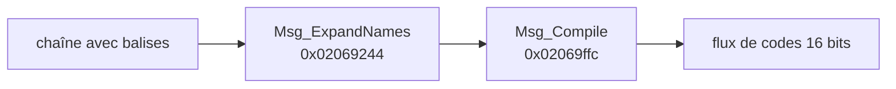

# Textes et balisage des messages

Les textes du jeu sont des chaînes ASCII avec balises `<…>`, stockées dans les tables
d'enregistrements (`table.md`) et dans les fichiers `.nat`. Une langue par fichier
(`_de`, `_en`, `_es`, `_fr`, `_it`). Le jeu interprète les balises à l'exécution.

`cargo dq9re text --lang en` écrit toutes les chaînes des tables dans `build/text/en/`
(51 089 chaînes en anglais, 1 441 fichiers).

## Caractères

- Pas d'octets non ASCII dans les textes européens : accents et signes spéciaux sont des
  balises — `<'e>` (é), `<^e>` (ê), `` <`a> `` (à), `<'E>`, `<ss>` (ß), `<1>` (apostrophe),
  `<,>` (virgule) **[hypothèse : glyphes distincts de la police, ex. typographie]**, `<!>`
  (espace insécable + `!` en français) **[hypothèse]**.
- Retour à la ligne : les deux caractères `\n` (barre oblique inverse + `n`), ou `\r\n`/`\n`
  réels ; tous deviennent le code `0xFF18`.
- `//Nom//` en début de réplique : nom de l'orateur **[hypothèse : affiché dans un cadre]** ;
  `*:` = orateur anonyme.

## Pipeline (ARM9)

Deux passes, retrouvées à partir des tables de balises (noms dans `re/symbols.txt`) :



### 1. `Msg_ExpandNames` : substitutions

- `g_MsgSubstTags` (`0x020e7e9c`) : `<HERO>`, `<LEADER>`, `<ADDRESSEE>`, `<TMAP_SEC…>`,
  `<STR_n>`, `<SIZE=…>` (sans gestionnaire), chacune avec une fonction `MsgSubst_*`. Un chiffre
  après le nom est passé comme indice (moins 1).
- `g_MsgGrammarTags` (`0x020e7f14`) : balises composées comme `<INDEF_ART_SGL_I_NAME>` ou
  `<DEF_ART_SGL_M_NAME>`. Chaque préfixe fixe un paramètre grammatical :

  | Préfixe | Genre de paramètre | Valeur |
  |---|---|---|
  | `DEF_` / `INDEF_` | article défini / indéfini | 0 / 1 |
  | `ART_` | avec article | 1 |
  | `SGL_` / `PLR_` | singulier / pluriel | 0 / 1 |
  | `NOM_` / `GEN_` / `DAT_` / `ACC_` | cas (allemand) | 0 / 1 / 2 / 3 |
  | `I_NAME`, `M_NAME`, `ACTOR`, `TARGET`, `ACTION`, `REFLEX` | entité nommée (objet, monstre, acteur, cible, action, ?) | lue dans le contexte du message |

  Le nom fléchi est produit par `FUN_020e4968` **[hypothèse : `Msg_InflectName`]**.
- `[WPN…]` et `[ACTER…]` : insertion du nom d'arme / de l'acteur courant.

### 2. `Msg_Compile` : codes de contrôle

`g_MsgControlTags` (`0x020e7f94`) associe 40 balises à des fonctions `MsgCtl_*` qui écrivent
un code 16 bits (suivi d'éventuels paramètres pour les balises `=`) :

| Code | Balise | Code | Balise |
|---|---|---|---|
| FF01 | `<END>` | FF13 | `<QUEST_FAILED>` |
| FF02 | `<END_R_TURN>` | FF14 / FF15 | `<YES>` / `<NO>` |
| FF03 | `<CLOSE>` | FF16 / FF17 | `<UKE>` / `<YAME>` |
| FF04 / FF05 | `<YESNO>` / `<NOYES>` | FF18 | retour à la ligne |
| FF06 / FF07 | `<YESNO_NOTSE>` / `<YESNO_NOTSE_IIE>` | FF1A | `<TIME=>` |
| FF08 | `<UKEYAME>` | FF1C | `<ST=>` |
| FF0A | `<ADD>` | FF1D / FF1E / FF1F | `<PAD_WAIT>` / `<PAD_T=>` / `<PAD_WAIT_NOCUR>` |
| FF0B | `<AUTO=>` | FF26 / FF27 | `<WIN_ON>` / `<WIN_OFF>` |
| FF0C / FF0D | `<PAGE_T=>` / `<PAGE>` | FF28 / FF29 | `<CEN_ON>` / `<CEN_OFF>` |
| FF0E | `<SHAKE>` | FF2B / FF2C / FF2D | `<N_TURN>` / `<R_TURN>` / `<TURN_P>` |
| FF0F / FF10 / FF11 | `<QUEST_SE>` / `<QUEST=>` / `<QUEST_HAN>` | FF2E / FF2F | `<EXC>` / `<QES>` |
| FF12 | `</QUEST>` | FFD0 / FFE0 | `<LB_x>` / `<JP_x>` (base + paramètre) |

`<ALL_RECOVER=…>` et `<TURN=…>` ont une logique propre (pas de code simple).
Autres cas de `Msg_Compile` : `<VOICE_VOLUME=n>`, `<ME_n>`, `<SE_n>` (sons) ; les balises
commençant par `<INN=`, `<CHURCH=`, `<BANK>`, `<SHOP`, `RENKIN` sont ignorées à ce stade
(`g_MsgSkippedTagPrefixes`). Un caractère hors balise est copié tel quel.

## Fréquence des balises (textes anglais)

Les plus courantes : `<n>` chiffres (137 696, ex. `<1>` apostrophe), `<,>` (105 096), `<PAGE>`
(71 542), `<END>` (30 625), `</QUEST>`, `<HERO>`, `<CLOSE>`, `<PAD_WAIT_NOCUR>`, `<QUEST=n>`,
`<Cap>` (majuscule sur le mot suivant **[hypothèse]**), conditionnels
`<IF_HERO_MALE>…<ELSE_HERO_NOT_MALE>…<ENDIF_HERO_MALE>` (et `_MALE`, `_SOLO`, `_ALONE`,
`_ADDRESSEE_MALE`, `_SING`, `_PLRNOUN`).

**Non localisés dans le code** : `<Cap>`, les conditionnels `IF_…`, les accents `<'e>`. Ils sont
traités ailleurs (avant la passe 1, ou par le moteur de police) **[à rechercher]**.

## Fichiers `.nat` (partiel)

Variante simple (480 des 583 `.nat`, ex. `bin/strstd/strstd_en.nat`) :

```
u32  bits 0-11 : nombre d'entrées n ; bits 12-31 : taille du bloc de chaînes
(u32 identifiant, u32 décalage)[n]
bloc de chaînes
```

Les autres `.nat` (`prm/*`, `bin/bstr/bstr5xx`…) sont des tables binaires d'un autre format
**[à documenter]**.
