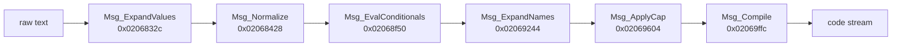

# Texts and message markup

Game texts are ASCII strings with `<…>` tags, stored in record tables
(`table.md`) and in `.nat` files. One language per file
(`_de`, `_en`, `_es`, `_fr`, `_it`). The game interprets tags at runtime.

`cargo dq9re text --lang en` writes every table string into `build/text/en/`
(51,089 English strings, 1,441 files).

## Reimplementation

`crates/dq9-formats/src/message.rs` reproduces the six passes (one function per pass, game
state supplied by closures). `cargo dq9re msg <archive.gp2> <member> [n]` runs a
dialogue through the whole pipeline with a preview context (hero "Hero", first branch of
each condition) and draws the pages with the game font (`build/msg.png`).

Test `message_pipeline_leaves_only_glyphs`: the 272,484 table strings (5 languages)
go through the pipeline; afterwards every text byte is a glyph or a space, except these
tags left to other systems **[not located]**:

| Tag | Hypothesis |
|---|---|
| `<RIKKA>`, `<LUIDA>`, `<DAMA>`, `<RENKIN>` | character / place names (Rikka, Luida…) replaced elsewhere; `RIKKA` appears in the ARM9 at `0x020f0ab1` |
| `<CEN>` | **leading tag**, consumed before compilation by `Msg_ConsumeLeadingTags` (`0x0206a3d0`, with `<N_TURN>`, `<EXC>`, `<QES>`, `<WIN>`, `<GYOU=n>`, `<MOJI=l,h>`, `<COLOR=r,g,b>`, `<RECT=x,y,l,h>`, `<SKIP>`): `message::leading_tags`; the narration card window, see [`dialogue.md`](dialogue.md) § "Message window" |
| `<TC#>`, `<PLTT=#>` | text color / palette; `<TC…>` does not exist in English texts, `<PLTT=>` only in menus |
| `<W=#>`, `<CURSOR=#>`, `<TRI-L>`, `<TRI-R>`, `<LG>` | menu layout (5 menu strings for `<W=>`, no NPC line) |

Add two typos in the data (`<ADDRESSE>`, and a block closed by
`<END_IF_MALE>` instead of `<ENDIF_MALE>`), and `<END>`/`<END_R_TURN>` that follow a
tag removed by `Msg_Compile` (`<INN=…>`…): the game then copies the following `<` as
text. **[To check in an emulator: these messages may go through another path.]**

## Characters

- No non-ASCII bytes in European texts: accents and special signs are font
  **glyph names** (`font.md`) — `<'e>` (é), `<^e>` (ê), `` <`a> `` (à),
  `<ss>` (ß), `<1>` (typographic apostrophe), `<,>`, `<heart>`… The engine takes the **first**
  glyph, in table order, whose string starts at the current position.
- Line break: the two characters `\n` (backslash + `n`), or real `\r\n`/`\n`;
  all become code `0xFF18`.
- `//Name//` at page start: speaker name, in a plate above the window
  (`MsgWin_ParseSpeakerName`, `dialogue.md`); `*:` = anonymous speaker, drawn as is (glyphs
  `*` and `:`).

## Pipeline (ARM9)

`Msg_Prepare` (`0x02067ea8`) chains six passes, each copying from one buffer to another (names
in `re/symbols.txt`):



Tag delimitation: from `<` to the first `>` **not followed** by another `>`
(`Msg_FindTagEnd`, `0x020424bc`), so that the glyph `<>>>` (») stays readable.

### 0. `Msg_ExpandValues`: numeric values

Table `0x020e7e6c`: `<val_n>` / `<VAL_n>` → `MsgSubst_VAL` (`0x02068248`), which inserts the
n-th value passed to the message.

### 1. `Msg_Normalize`: font filtering

For each position: a glyph string is copied as is; otherwise a `<…>` tag
is copied **uppercased** (`<Cap>` → `<CAP>`, `<str_1>` → `<STR_1>`); otherwise ` `,
`/`, `\n` are copied; any other byte becomes `< >` (space glyph).

### 2. `Msg_EvalConditionals`: conditional blocks

56 rules (`g_MsgCondRules`, `0x020e834c`), built from 52 keywords
(`g_MsgCondKeywords`, `0x020e80dc`) joined by `_`. Each rule has a start tag, one or
two intermediate tags and an end tag, plus a `MsgCond_*` function returning
the index of the branch to keep:

| Form | Example | Branches |
|---|---|---|
| if / else | `<IF_HERO_MALE>a<ELSE_HERO_NOT_MALE>b<ENDIF_HERO_MALE>` | 0 = `a`, 1 = `b` |
| gender M/F/N | `<IF_I_NAME_M>a<IF_I_NAME_F>b<IF_I_NAME_N>c<ENDIF_I_NAME_MFN>` | 0, 1, 2 |

The chosen branch is kept, the rest up to the end tag is removed
(`Msg_SelectBranch`, `0x02068e2c`). Condition families: sex (`MALE`, `HERO_MALE`,
`ACTOR_MALE`…), party (`SOLO`, `ALONE`, `FEMALE_PARTY`, `TARGET_PARTY`…), number
(`SING VAL_n`, `PLRNOUN`), grammatical gender (`_M/_F/_N`), vowel initial (`VOWEL_…`,
`VOWEL_FR_…` for elision), last letter `s` (`LAST_LETTER_S_…`, German genitive).
Example read: `MsgCond_MALE` returns bit 0 of byte `+0x49c` of the hero structure
**[hypothesis: 1 = female]**.

### 3. `Msg_ExpandNames`: substitutions

- `g_MsgSubstTags` (`0x020e7e9c`): `<HERO>`, `<LEADER>`, `<ADDRESSEE>`, `<TMAP_SEC…>`,
  `<STR_n>`, `<SIZE=…>` (no handler), each with a `MsgSubst_*` function. A digit
  after the name is passed as an index (minus 1).
- `g_MsgGrammarTags` (`0x020e7f14`): compound tags such as `<INDEF_ART_SGL_I_NAME>` or
  `<DEF_ART_SGL_M_NAME>`. Each prefix sets a grammatical parameter:

  | Prefix | Parameter kind | Value |
  |---|---|---|
  | `DEF_` / `INDEF_` | definite / indefinite article | 0 / 1 |
  | `ART_` | with article | 1 |
  | `SGL_` / `PLR_` | singular / plural | 0 / 1 |
  | `NOM_` / `GEN_` / `DAT_` / `ACC_` | case (German) | 0 / 1 / 2 / 3 |
  | `I_NAME`, `M_NAME`, `ACTOR`, `TARGET`, `ACTION`, `REFLEX` | named entity (item, monster, actor, target, action, ?) | read from the message context |

  The inflected name is produced by `FUN_020e4968` **[hypothesis: `Msg_InflectName`]**.
- `[WPN…]` and `[ACTER…]`: insertion of the current weapon / actor name.

### 4. `Msg_ApplyCap`: capitalization

`<CAP>` (written `<Cap>` in the data, uppercased by pass 1) is removed; if
the next glyph is marked lowercase in the font, its string is uppercased
(`a`→`A`, `<'e>`→`<'E>`, ASCII `a-z` conversion only).

### 5. `Msg_Compile`: control codes

`g_MsgControlTags` (`0x020e7f94`) maps 40 tags to `MsgCtl_*` functions that write
a 16-bit code (followed by optional parameters for `=` tags):

| Code | Tag | Code | Tag |
|---|---|---|---|
| FF01 | `<END>` | FF13 | `<QUEST_FAILED>` |
| FF02 | `<END_R_TURN>` | FF14 / FF15 | `<YES>` / `<NO>` |
| FF03 | `<CLOSE>` | FF16 / FF17 | `<UKE>` / `<YAME>` |
| FF04 / FF05 | `<YESNO>` / `<NOYES>` | FF18 | line break |
| FF06 / FF07 | `<YESNO_NOTSE>` / `<YESNO_NOTSE_IIE>` | FF1A | `<TIME=>` |
| FF08 | `<UKEYAME>` | FF1C | `<ST=>` |
| FF0A | `<ADD>` | FF1D / FF1E / FF1F | `<PAD_WAIT>` / `<PAD_T=>` / `<PAD_WAIT_NOCUR>` |
| FF0B | `<AUTO=>` | FF26 / FF27 | `<WIN_ON>` / `<WIN_OFF>` |
| FF0C / FF0D | `<PAGE_T=>` / `<PAGE>` | FF28 / FF29 | `<CEN_ON>` / `<CEN_OFF>` |
| FF0E | `<SHAKE>` | FF2B / FF2C / FF2D | `<N_TURN>` / `<R_TURN>` / `<TURN_P>` |
| FF0F / FF10 / FF11 | `<QUEST_SE>` / `<QUEST=>` / `<QUEST_HAN>` | FF2E / FF2F | `<EXC>` / `<QES>` |
| FF12 | `</QUEST>` | FFD0 / FFE0 | `<LB_x>` / `<JP_x>` (base + parameter) |

`<ALL_RECOVER=…>` and `<TURN=…>` have their own logic (no simple code).
Other `Msg_Compile` cases: `<VOICE_VOLUME=n>`, `<ME_n>`, `<SE_n>` (sounds); tags
starting with `<INN=`, `<CHURCH=`, `<BANK>`, `<SHOP`, `RENKIN` are ignored at this stage
(`g_MsgSkippedTagPrefixes`). A character outside a tag is copied as is.

## Tag frequency (English texts)

Most common: `<n>` digits (137,696, e.g. `<1>` apostrophe), `<,>` (105,096), `<PAGE>`
(71,542), `<END>` (30,625), `</QUEST>`, `<HERO>`, `<CLOSE>`, `<PAD_WAIT_NOCUR>`, `<QUEST=n>`,
`<Cap>`, conditionals `<IF_HERO_MALE>…<ELSE_HERO_NOT_MALE>…<ENDIF_HERO_MALE>` (and `_MALE`,
`_SOLO`, `_ALONE`, `_ADDRESSEE_MALE`, `_SING`, `_PLRNOUN`).

**Still unknown**: the name inflection function (`FUN_020e4968`) and the final
conversion of bytes into glyphs after `Msg_Compile` (`FUN_0206a984`). The vowel test
(`FUN_02067ffc`) is reimplemented by `message::starts_with_vowel`: first glyph a vowel,
or `h` + vowel + non-vowel (silent h), or `y` + non-vowel; the game first checks an
entity-specific flag.

## `.nat` files (partial)

Simple variant (480 of the 583 `.nat`, e.g. `bin/strstd/strstd_en.nat`):

```
u32  bits 0-11: entry count n; bits 12-31: string block size
(u32 identifier, u32 offset)[n]
string block
```

The other `.nat` (`prm/*`, `bin/bstr/bstr5xx`…) are binary tables of another format
**[to document]**.
